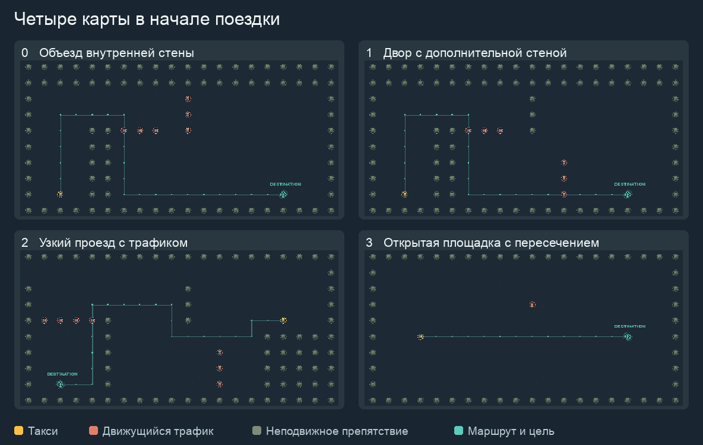

# Assignment 1 — Campus Taxi

**Автор** — Карим Хабибрахманов / Karim Khabibrakhmanov<br>
**Курс** — [F26] Introduction to Adaptive and Efficient Machine Learning, Innopolis

Робо-такси должно объехать препятствия, доехать до цели и остановиться. В первой работе реализованы среда на JAX и демонстрационный водитель. Во второй на этой среде обучен водитель на основе PPO. [Подробный отчёт](REPORT.md) · [Видео](artifacts/demo.mp4) · [Результаты и файлы](artifacts/) · [Assignment 2](https://github.com/Karimkhab/adaptive-and-efficient-ml/tree/Submission/assignment-2)

## Карты



| `--map` | Откуда взята | Что проверяем |
| --- | --- | --- |
| `0` | Заготовка курса | Объезд внутренней стены и разъезд с трафиком. |
| `1` | Заготовка курса | Объезд дополнительной стены в центре и торможение в зоне трафика рядом с целью. |
| `2` | Заготовка курса | Проезд справа налево через узкий участок с движущимися препятствиями. |
| `3` | Добавлена в работе | На открытой площадке одна машина пересекает прямой маршрут такси. Так можно отдельно проверить реакцию на трафик и остановку у цели. |

На рисунке показаны стартовые позиции и опорные маршруты. Во всех сценах размер клетки равен 5, а радиус физического коллайдера машины и препятствий — 1 условная единица. [Что взяли из заготовки и что реализовали](REPORT.md#maps-and-scope) · [Физика и столкновения](REPORT.md#vehicle-dynamics)

Карту 4 добавили для проверки переноса во второй работе. `--map 4` открывает объезд островка, а `--map 4 --cross-traffic` добавляет машину на выезде. [Обе планировки и траектории](../assignment-2/artifacts/map4_validation/README.md)

## Как устроена среда

Класс `RobotaxiEnv` создаёт карту, начинает поездку через `reset` и выполняет один шаг через `step`. Водитель задаёт газ или тормоз и угол руля. Среда обновляет положение машины и трафика, проверяет столкновение и парковку, затем возвращает новое наблюдение и награду. [Схема шага, методы и таблица завершения](REPORT.md#environment-api)

В наблюдении **70 чисел**. Шесть описывают скорость, цель и маршрут. Ещё по 32 передают дальности до препятствий или края и проекции относительной скорости на лучи. Лучи покрывают полный круг. [Что видит водитель и как начисляется награда](REPORT.md#observations-and-reward)

**JAX** считает движение, наблюдения и награду. Он компилирует повторяющийся шаг среды, а во второй работе позволяет считать много поездок пакетом. По умолчанию физика использует **`float32`**, как при обучении PPO. Для проверки округления можно включить **`float64`**. На одних и тех же 32 сценариях оба режима дали 32 парковки, хотя минимальный зазор немного различался. Вектор наблюдений для PPO в обоих режимах остаётся `float32`. [Что меняет точность и почему оставили float32 по умолчанию](REPORT.md#jax-precision)

## Как запустить

Нужен Python 3.12. Команды используют CPU. Сначала клонируйте ветку для сдачи.

```bash
git clone --branch Submission https://github.com/Karimkhab/adaptive-and-efficient-ml.git
cd adaptive-and-efficient-ml/assignment-1
```

**macOS / Linux**

```bash
python3.12 -m venv .venv
source .venv/bin/activate
python -m pip install -r requirements-lock.txt
python src/main.py --map 2 --demo
```

**Windows PowerShell**

```powershell
py -3.12 -m venv .venv
.\.venv\Scripts\python.exe -m pip install -r requirements-lock.txt
.\.venv\Scripts\python.exe src/main.py --map 2 --demo
```

Без флага `--demo` машиной можно управлять с клавиатуры.

- **W/↑, S/↓** — газ и тормоз. **A/←, D/→** — руль.
- **Tab** — переключить демо и ручное управление. **Space** — пауза. **R** — начать заново.
- **1–4** — выбрать карту. **Z** — переключить общий вид и камеру машины.
- **L** — показать лучи. **C** — показать коллайдеры. **Esc** — выход.

<a name="reproduce"></a>

## Как повторить проверки

```bash
python -m pytest -q
python src/evaluate.py
python src/scenarios.py
python examples/rl_smoke.py
python src/make_video.py
```

В Windows используйте `.\.venv\Scripts\python.exe` вместо `python`. Запись по умолчанию воспроизводится с ускорением 2×. Для реального времени запустите `python src/make_video.py --speed 1`.

Для проверки физики в `float64` запустите `JAX_ENABLE_X64=1 python src/scenarios.py --output artifacts/scenarios-float64.json`. В PowerShell сначала задайте `$env:JAX_ENABLE_X64 = "1"`, затем запустите Python-команду без префикса.

На Ubuntu и Windows прошли **44 теста и 32 сценария** на каждой системе. [Проверки и результаты поездок](REPORT.md#evaluation) · [Запуск GitHub Actions](https://github.com/Karimkhab/adaptive-and-efficient-ml/actions/runs/42496985617)

## Где код

- [`src/env/robotaxi.py`](src/env/robotaxi.py) — динамика, состояния, действия, наблюдения, награда, коллизии.
- [`src/controller.py`](src/controller.py) — демонстрационный водитель с доступом к полному состоянию.
- [`src/main.py`](src/main.py), [`src/utils/taxi_renderer.py`](src/utils/taxi_renderer.py) — запуск, ввод и рендерер.
- [`tests/`](tests/) — физика, движение препятствий, ручное управление и полные поездки.

[`MANIFEST.json`](MANIFEST.json) хранит список файлов комплекта и их контрольные суммы SHA-256. По нему можно сверить ZIP и файлы репозитория. Видео, цифры и исходные данные собраны в [указателе артефактов](artifacts/).
