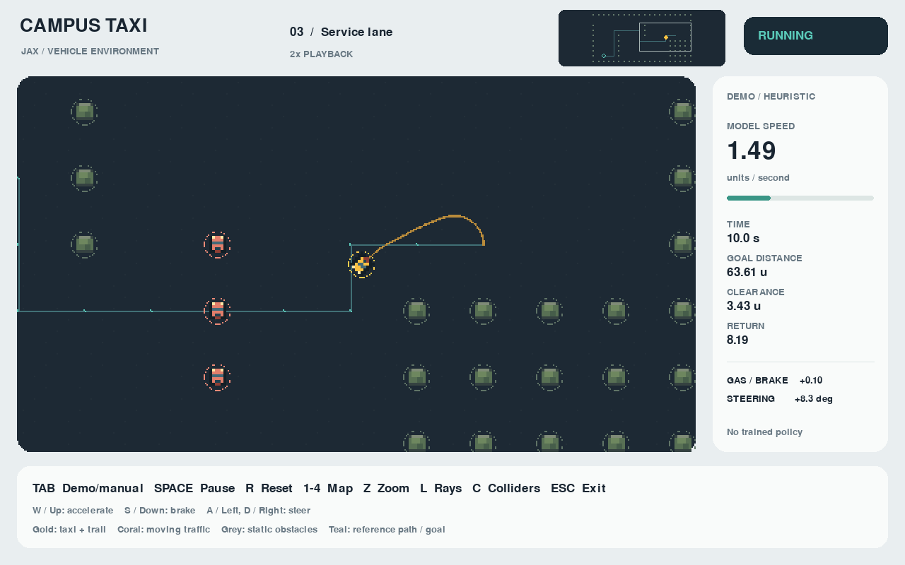

# Assignment 1 — Campus Taxi

**Автор:** Карим Хабибрахманов / Karim Khabibrakhmanov  
**Курс:** [F26] Introduction to Adaptive and Efficient Machine Learning, Innopolis

Простая 2D-среда автомобиля на JAX: газ, тормоз, руль, препятствия, цель,
наблюдения и награда. Пиксельный рендерер показывает движение и физические
коллизии; автоматический водитель демонстрационный, без RL-обучения.

[Отчёт](REPORT.md) · [Видео](artifacts/demo.mp4) · [Результаты](artifacts/evaluation.json)



## Установка

Нужен **Python 3.12**, CPU. Docker и GPU не требуются. Сначала:

```bash
git clone --branch Submission https://github.com/Karimkhab/adaptive-and-efficient-ml.git
cd adaptive-and-efficient-ml/assignment-1
```

Linux / macOS:

```bash
python3.12 -m venv .venv
source .venv/bin/activate
python -m pip install -r requirements-lock.txt
```

Windows PowerShell (активация окружения не нужна):

```powershell
py -3.12 -m venv .venv
.\.venv\Scripts\python.exe -m pip install -r requirements-lock.txt
.\.venv\Scripts\python.exe src/main.py --map 2 --demo
```

Для остальных команд ниже на Windows используйте `.\.venv\Scripts\python.exe`
вместо `python`. Поддерживаемые цели: macOS arm64, Linux x86-64 и Windows x86-64.
Нативные проверки Linux/Windows выполняет
[GitHub Actions](https://github.com/Karimkhab/adaptive-and-efficient-ml/actions/workflows/assignment-1.yml):
тесты, 32 сценария, интерфейс RL, запись и декодирование видео без дисплея.
[Подтверждённый прогон](https://github.com/Karimkhab/adaptive-and-efficient-ml/actions/runs/41313584149):
на каждой ОС 41/41 тест и 32/32 сценария.

## Запуск и управление

```bash
python src/main.py --map 2 --demo   # автоматическая поездка
python src/main.py --map 0          # управление с клавиатуры
```

- **W/↑, S/↓** — газ и тормоз; **A/←, D/→** — руль.
- **Tab** — демо / ручное управление; **Space** — пауза; **R** — новый эпизод.
- **1–4** — выбор карты; **Z** — общий вид / камера машины.
- **L** — лучи датчиков; **C** — круги коллизий; **Esc** — выход.

Карты CLI 0–2 соответствуют раскладкам преподавателя, карта 3 — дополнительное
пересечение. Жёлтая машина — агент, коралловые — движущиеся препятствия,
серо-зелёные — статические; бирюзовые линия и метка показывают путь и цель.
Корпуса нарисованы внутри круглых коллайдеров радиуса 1. Размер клетки — 5.
Камера и пиксельная сетка влияют только на рисунок, а не на состояние среды.

## Проверки и видео

```bash
python -m pytest -q
python src/evaluate.py
python src/scenarios.py
python examples/rl_smoke.py
python src/make_video.py           # MP4, 1280×800, 30 FPS, воспроизведение 2x
python src/make_video.py --speed 1 # запись в реальном времени
```

В `artifacts/` сохранены 41 пройденный тест, четыре базовые поездки, результаты
32 вариантов старта/трафика, CSV и видео. Успех требует остановки в радиусе 1
со скоростью не выше 0.001; таймаут — 3000 шагов / 100 секунд.
Симуляция всегда работает с шагом 1/30 с; при ускорении видео есть метка 2x,
а таймер показывает время симуляции. Сценарии детерминированы; это проверка среды,
а не оценка обученного агента. Подробности и ограничения — в отчёте.

## Интерфейс для Assignment 2

Наблюдение **v2** — 70 чисел `float32` при 32 лучах: скорость, цель и путь в
системе машины, расстояние до пути, дальности и скорости сближения по лучам.
Старый формат v1 из 38 чисел больше не используется. Действие `(2,)` в `[-1,1]`:
ускорение/тормоз и руль. Размер: `RobotaxiEnv.observation_size(params)`.

`step` возвращает `(obs, state, reward, done, info)`. `done` заканчивает эпизод;
`info["terminated"]` означает успех/столкновение, `info["truncated"]` — таймаут.
`AutoResetWrapper` сохраняет настоящее `info["final_observation"]` до reset;
`info["final_observation_valid"]` отмечает завершившийся переход. Для bootstrap
на таймауте используется последнее наблюдение, а маска равна `1 - terminated`.

`reset(key, params, initial, randomize=True)` воспроизводимо варьирует курс
(±10°), скорость (0–0.5), темп трафика (0.8–1.2) и его фазу (0–1 с), сохраняя
формы массивов. По умолчанию reset фиксированный. Есть пакетный JIT/vmap-тест
и пример политики, получающей только наблюдение, в `examples/rl_smoke.py`.
Это подготовка интерфейса; RL-модель ещё не обучалась.

## Где код и источники

- `src/env/robotaxi.py` — динамика, состояния, действия, наблюдения, награда, коллизии.
- `src/controller.py` — демонстрационный водитель с доступом к полному состоянию.
- `src/main.py`, `src/utils/taxi_renderer.py` — запуск, ввод и рендерер.
- `tests/` — физика, движения препятствий, ручное управление и полные поездки.

Заготовка: [InnoRL/IAEML-assignment](https://github.com/InnoRL/IAEML-assignment/tree/1056d711e166747cc485725e31f2535967b030dd),
коммит `1056d711e166747cc485725e31f2535967b030dd`. Сохранены исходные `base.py`,
`tasks.py`, `utils/renderer.py` и `utils/utils.py`; новая среда наследует `BaseEnv`.
Модель: [Robotics Toolbox — Bicycle](https://petercorke.github.io/robotics-toolbox-python/mobile-vehicle-bicycle.html).
Для визуального оформления использованы рекомендации [game-graphics](https://github.com/fenre/skills/blob/main/game-graphics/SKILL.md):
маленькие спрайты, ограниченная палитра, увеличение без сглаживания. Графика
нарисована кодом Pygame; внешние изображения и новые графические библиотеки не нужны.
Требования: Assignments.pdf от 30 сентября 2026 и [Stage 1](https://github.com/InnoRL/IAEML-assignment/blob/1056d711e166747cc485725e31f2535967b030dd/instructions/stage_1.md).
