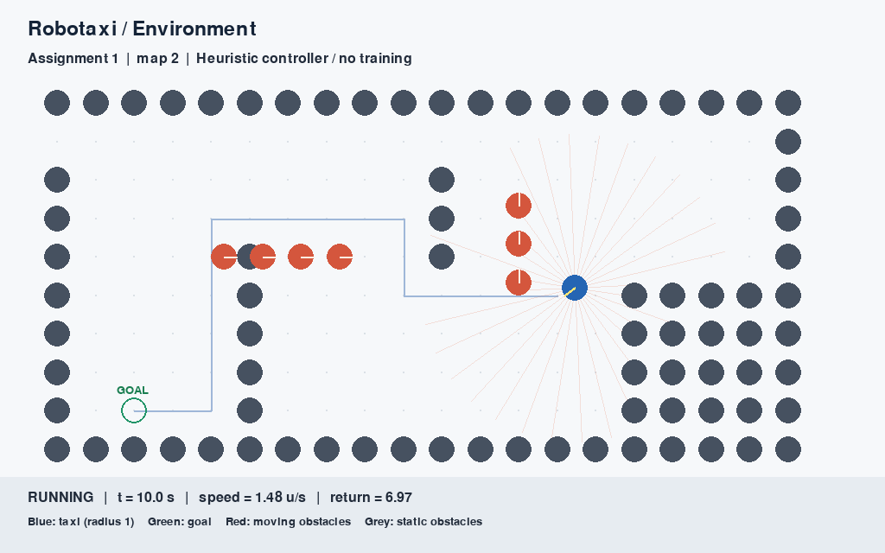

# Assignment 1 — Robotaxi Environment

**Автор:** Карим Хабибрахманов / Karim Khabibrakhmanov  
**Курс:** [F26] Introduction to Adaptive and Efficient Machine Learning, Innopolis  
**Дата проверки:** 25 октября 2026

Среда автомобиля на JAX: ускорение и руль, сопротивление движению, лучевые
наблюдения, награда, статические и движущиеся препятствия. Класс `RobotaxiEnv`
наследуется от выданного `BaseEnv`. Исходные карты сохранены; масштаб клетки — 3,
радиус каждого физического объекта — 1.

Этот репозиторий содержит **Assignment 1**. Автоматическая демонстрация использует
эвристический контроллер с доступом к полному состоянию. RL-обучение и checkpoint
относятся к Assignment 2 и здесь не представлены.

## Материалы

- [Отчёт](REPORT.md): модель, наблюдения, награда, трудности, результаты.
- [Видео](artifacts/demo.mp4): реальные поездки на картах 0, 2 и 3, 30 кадров/с.
- [Численные результаты](artifacts/evaluation.json) и `artifacts/trajectory_map*.csv`.
- [Результат тестов](artifacts/tests.txt).
- [Источники и изменения относительно заготовки](UPSTREAM.md).
- [Порядок сдачи](SUBMISSION.md).



## Репозиторий сдачи

Материалы находятся в `assignment-1/` репозитория
[Karimkhab/adaptive-and-efficient-ml](https://github.com/Karimkhab/adaptive-and-efficient-ml).
Ветка для проверки — **`Submission`**. Требования и карта материалов:
[SUBMISSION.md](SUBMISSION.md).

## Установка с нуля

Проверено на **Python 3.12.14, macOS arm64, JAX CPU**. Используйте Python 3.12;
запуск на других платформах в этой работе не проверялся. После клонирования
перейдите в **`assignment-1`**; там лежат `requirements-lock.txt` и `src/`.

```bash
git clone --branch Submission https://github.com/Karimkhab/adaptive-and-efficient-ml.git
cd adaptive-and-efficient-ml/assignment-1
python3.12 -m venv .venv
source .venv/bin/activate
python -m pip install -r requirements-lock.txt
python -m pip check
```

`requirements.txt` перечисляет прямые зависимости; `requirements-lock.txt` фиксирует
также транзитивные версии проверенного окружения. CUDA и внешние сервисы не нужны.
Видео кодируется FFmpeg, который поставляется Python-пакетом `imageio-ffmpeg`.

## Запуск

Ручное управление в Pygame:

```bash
JAX_PLATFORM_NAME=cpu python src/main.py --map 0
```

W/↑ — газ; S/↓ — тормоз; A/← и D/→ — руль; R — новый эпизод; Esc — выход.
Без газа автомобиль замедляется. На месте руль не поворачивает машину.
После завершения эпизода состояние остаётся на экране до R или выхода.

Автоматическая демонстрация в окне:

```bash
python src/main.py --map 2 --demo
```

Значения `--map`: 0, 1, 2 — карты преподавателя; 3 — дополнительный сценарий
пересечения с движущимся препятствием. `--max-steps` задаёт лимит; по умолчанию
2400 шагов при 30 Гц, то есть 80 секунд симуляции.

## Воспроизведение результатов

```bash
JAX_PLATFORM_NAME=cpu python -m pytest -q
JAX_PLATFORM_NAME=cpu python src/evaluate.py
python src/make_video.py
```

Вторая команда пересоздаёт JSON и CSV четырёх поездок. Третья пересоздаёт видео,
PNG-кадры и `artifacts/demo.json`. Для отдельной записи:

```bash
python src/main.py --map 3 --demo --headless --record artifacts/map3.mp4
```

Seed по умолчанию равен 0. Карты и переходы детерминированы, поэтому смена seed
сама по себе не создаёт новую задачу. Время первого JIT-компилирования зависит от
компьютера. `execution_seconds` включает Python-цикл и проверки; это не отдельный
бенчмарк производительности, а при записи видео включает также рендеринг.

## Интерфейс для дальнейшей работы

```python
import jax
import jax.numpy as jnp
from env.robotaxi import RobotaxiEnv

key = jax.random.PRNGKey(0)
params, initial = RobotaxiEnv.init_params(key, map_id=0)
observation, state = RobotaxiEnv.reset(key, params, initial)
observation, state, reward, done, info = RobotaxiEnv.step(
    key, state, jnp.array([0.5, 0.0]), params
)
vector = observation.as_vector()  # float32, shape (38,) at 32 rays
```

Для импорта из своего скрипта добавьте `src` в `PYTHONPATH`. Действие имеет форму
`(2,)` и компоненты в `[-1, 1]`: нормированные ускорение/торможение и угол руля.
`step` и `reset` JIT-компилируются с фиксированными параметрами. Проверены `vmap`
по состояниям одной карты и совпадение с исполнением без JIT. Смена карты может
изменить формы массивов и вызвать перекомпиляцию.

Сырая среда после `done` сохраняет состояние и возвращает нулевую награду.
`AutoResetWrapper` позволяет явно выбрать автоматический reset. При этом
возвращаются начальные состояние/наблюдение, а награда, done и info относятся к
завершившемуся переходу. Перед обучением с bootstrap на таймауте обёртку следует
дополнить сохранением terminal observation.

## Ограничения

Это упрощённая модель: без заднего хода, бокового скольжения, инерции рулевого
механизма и столкновений препятствий друг с другом. Навигатор строит путь для
точки по статической карте, а не гарантированно допустимую траекторию автомобиля.
Однокадровые лучи не дают скоростей препятствий: наблюдение частично наблюдаемое.
Успех четырёх фиксированных демонстраций не доказывает надёжность на произвольных
картах и не является оценкой обученного агента.
