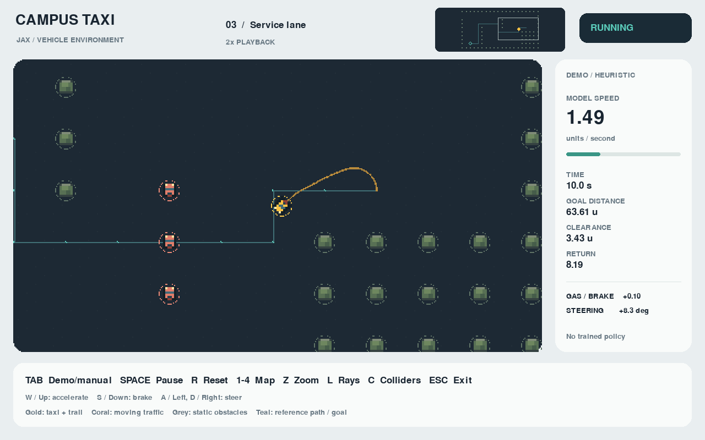
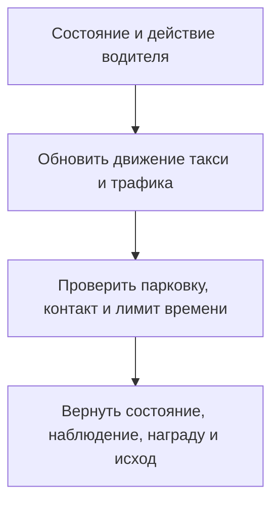

# Assignment 1 — симулятор робо-такси

**Автор** — Карим Хабибрахманов / Karim Khabibrakhmanov<br>
**Курс** — Introduction to Adaptive and Efficient Machine Learning, Innopolis, осень 2026<br>
**Эксперименты** — 1, 7 и 8 ноября 2026

В первой работе реализована среда на JAX, в которой автомобиль объезжает препятствия, едет к цели и останавливается рядом с ней. В среде можно ездить с клавиатуры или включить демонстрационного водителя, который выбирает действия по заданным правилам. Он припарковался во всех 32 проверенных сценариях, включая по одной базовой поездке на каждой из четырёх карт. В Assignment 2 в этой же среде обучается водитель на основе нейросети.



<a name="maps-and-scope"></a>

## 1. Что должна сделать машина

На карте есть цель, неподвижные препятствия и движущийся трафик. Заготовка курса задаёт три сетки размером 10×20. На них отмечены старт, цель, стены и два направления движения трафика. В этой работе они доступны как карты 0, 1 и 2. На карте 0 нужно объехать внутреннюю стену, на карте 1 появляется дополнительная стена и трафик около цели, на карте 2 нужно проехать с правой стороны к цели в левом нижнем углу. [Исходные раскладки в tasks.py](src/env/tasks.py)

Карта 3 добавлена в `RobotaxiEnv.init_params`. Это открытая площадка, где одно препятствие пересекает прямой путь от старта к парковке. Она позволяет отдельно наблюдать, как водитель реагирует на пересечение и тормозит у цели. На всех четырёх картах используются реализованные в работе динамика такси, датчики, награда и проверка столкновений. [Обзор карт и легенда](artifacts/maps.png)

Для парковки должны выполняться три условия.

- Центр машины находится не дальше 1 условной единицы от цели.
- Скорость не превышает 0.001 условной единицы в секунду.
- По пути не было столкновений.

При столкновении поездка завершается сразу. На парковку отведено 100 секунд симуляции. Ранний вариант засчитывал достижение цели по одному расстоянию, поэтому проезд мимо цели на скорости мог завершить поездку успехом. Теперь водитель должен затормозить обычным действием.

<a name="vehicle-dynamics"></a>

## 2. Почему машина движется именно так

У машины есть положение, курс и скорость. На каждом шаге водитель выбирает два числа. Первое задаёт разгон или торможение, второе — угол руля. Тормоз сильнее газа, чтобы машина могла заметно снизить скорость перед целью.

Модель сводит переднюю и заднюю оси к двум колёсам. Машина едет вдоль своего курса и поворачивает только в движении. Например, при одном и том же повороте руля быстрая машина меняет курс за секунду сильнее медленной. Без газа машина постепенно замедляется из-за сопротивления движению. Такой модели достаточно, чтобы воспроизвести разгон, поворот и остановку с небольшим числом параметров. Поведение шин и боковое скольжение остались за пределами модели. [Описание велосипедной модели](https://petercorke.github.io/robotics-toolbox-python/mobile-vehicle-bicycle.html).

Каждое препятствие и машина представлены кругами радиуса 1. Среда проверяет касание кругов между началом и концом шага. Касание края карты тоже завершает поездку. Минимальный зазор учитывает и препятствия, и край. На карте 2 первоначальное расстояние между клетками составляло 3 условные единицы. После проверки движения трафика выяснилось, что четыре объекта перекрывают проезд. Увеличение расстояния до 5 позволило сохранить раскладку карты и оставить место для объезда.

<details>
<summary>Формулы движения и параметры</summary>

В состоянии среды хранятся координаты машины `(x, y)`, курс `θ`, скорость `v`, а также время, цель, препятствия, маршрут и флаги завершения. В уравнениях `δ` обозначает угол руля, а `L = 1.5` — колёсную базу.

```text
dx/dt = v cos(θ)
dy/dt = v sin(θ)
dθ/dt = v tan(δ) / L
dv/dt = a − 0.18 v − 0.12  (с ограничением v от 0 до 5)
```

Действия `(u_a, u_δ)` ограничены диапазоном от −1 до 1. Ускорение `a = 3 u_a` при разгоне и `a = 5 u_a` при торможении. Угол руля `δ = 0.6 u_δ` радиан. Шаг составляет 1/30 секунды. Скорость ограничена диапазоном от 0 до 5. Газ слабее сопротивления оставляет машину в покое. Если скорость достигает нуля или предела 5 посреди шага, оставшуюся часть шага машина проходит с этой предельной скоростью. Пройденная дуга определяет поворот, положение обновляется по курсу в середине дуги. Коэффициенты сопротивления заданы в единицах ускорения и выбраны для учебной модели.

Путь вычисляется по четырём соседям клетки с учётом неподвижных препятствий. Раз в секунду среда проверяет расстояние до ближайшей точки маршрута. При отклонении больше одной клетки она ищет доступный вход в сетку и перестраивает путь. Трафик движется группами по осям карты. При опасности пересечения со стеной, границей или другой группой объекты разворачиваются вместе или пропускают шаг, если оба направления закрыты.

</details>

<a name="observations-and-reward"></a>

## 3. Что видит водитель и за что получает награду

Политика PPO из Assignment 2 получает вектор из 70 чисел. В нём есть текущая скорость, цель относительно машины и подсказка, куда ведёт ближайший участок маршрута. Ещё 32 луча по полному кругу измеряют расстояния до препятствий и краёв карты. Для каждого попадания также передаётся проекция относительной скорости на луч. Например, для края она положительна, если машина едет к нему.

Награда за шаг складывается из трёх частей.

- Чем сильнее машина приблизилась к цели по прямой, тем больше баллов за шаг.
- За каждую секунду поездки снимается 0.1 балла.
- Парковка даёт 100 баллов, столкновение снимает 100 баллов.

Промежуточные баллы дают обратную связь до конца поездки. Если машина вернётся на прежнее расстояние от цели, суммарная прибавка за приближение обнулится, а штраф за время останется. У этого правила есть ограничение. Чтобы объехать стену, иногда нужно сначала отдалиться от цели. В A2 отдельно проверено, как на обучение влияет награда за продвижение по маршруту.

<details>
<summary>Состав 70 чисел и формула награды</summary>

| Часть наблюдения | Чисел | Как масштабируется |
| --- | ---: | --- |
| Скорость машины | 1 | Делится на максимальную скорость 5 |
| Вектор до цели в координатах машины | 2 | Делится на диагональ карты |
| Направление маршрута в координатах машины | 2 | Единичный вектор |
| Расстояние до ближайшего отрезка маршрута | 1 | Делится на размер клетки 5 |
| Дальности по лучам | 32 | Делятся на предельную дальность 12 |
| Проекции относительной скорости на лучи | 32 | Делятся на сумму максимальной скорости машины и наибольшей текущей скорости препятствия |

Наблюдение имеет тип `float32`. При отсутствии препятствия и края в пределах дальности луч возвращает максимальную дальность и нулевую проекцию. Проекция использует вектор относительной скорости. Например, движущийся поперёк луча объект может менять точку пересечения с лучом при нулевой проекции.

Формула награды за шаг использует расстояние до цели `d`.

```text
r_t = d_t − d_{t+1} − 0.1 Δt + 100 · парковка − 100 · столкновение
```

</details>

<a name="environment-api"></a>

### Как проходит один шаг среды



Класс `RobotaxiEnv` наследует `BaseEnv` из заготовки и переиспользует расчёт пересечения луча с кругом. Логика поездки реализована в `RobotaxiEnv`. [Класс и методы](src/env/robotaxi.py#L217)

| Метод | Что делает |
| --- | --- |
| `init_params(..., map_id=...)` | Выбирает карту, задаёт физические параметры и создаёт стартовое состояние с опорным маршрутом. |
| `reset(..., randomize=True)` | Начинает поездку. Случайный режим воспроизводимо варьирует курс, скорость такси, скорость и фазу трафика. По умолчанию старт фиксированный. |
| `step(key, state, action, params)` | Выполняет один шаг длительностью 1/30 с и возвращает `(obs, state, reward, done, info)`. Действие состоит из двух чисел от −1 до 1. Первое задаёт газ или тормоз, второе — руль. |
| `get_observation(state, params)` | Собирает показания датчиков, скорость, относительное положение цели и подсказку маршрута. `as_vector()` превращает их в вход политики. |

В `info` есть отдельные признаки парковки и столкновения. Для обучения важно отличать эти исходы от лимита времени.

| Исход шага | `done` | `info["terminated"]` | `info["truncated"]` |
| --- | --- | --- | --- |
| Поездка продолжается | `False` | `False` | `False` |
| Парковка или столкновение | `True` | `True` | `False` |
| Истекли 100 секунд | `True` | `False` | `True` |

При автоматическом сбросе `obs` уже относится к следующей поездке. `info["final_observation"]` сохраняет последнее наблюдение завершившейся поездки, а `final_observation_valid` отмечает завершившийся переход. При таймауте PPO оценивает продолжение по этому последнему наблюдению. При парковке или столкновении будущая награда считается нулевой. [Пример перехода с автосбросом](examples/rl_smoke.py) · [Реализация PPO в Assignment 2](https://github.com/Karimkhab/adaptive-and-efficient-ml/blob/Submission/assignment-2/src/ppo.py)

<a name="evaluation"></a>

## 4. Что проверили в поездках

Для проверки среды использован демонстрационный водитель. Он ведёт машину по маршруту и видит положения и скорости всех препятствий. Ранние проверки выявили две проблемы. При старте поперёк маршрута машина могла застрять, а торможение на пути движущегося препятствия иногда вело к столкновению.

Водитель сравнивает девять комбинаций газа и руля, моделируя ближайшие 1.8 секунды. Он предпочитает варианты, в которых остаётся зазор хотя бы 0.3 условной единицы. Среди них выбирает манёвр, который продвигает машину по маршруту и выравнивает её курс. Маршрут сохраняется при обычном движении вдоль него, чтобы подсказка для поворота не менялась при каждом небольшом отклонении.

В таблице по одной поездке с обычным стартом на каждой карте. Время отсчитывается внутри симуляции. Зазор — минимальное расстояние между краями машины и ближайшего препятствия или края карты за поездку. Чем ближе оно к нулю, тем ближе машина была к касанию.

| Карта | Время до парковки, с | Расстояние до цели при остановке | Скорость при остановке | Минимальный зазор |
| --- | ---: | ---: | ---: | ---: |
| 0 | 45.83 | 0.409 | 0.000000 | 0.304 |
| 1 | 45.47 | 0.406 | 0.000000 | 0.310 |
| 2 | 51.30 | 0.491 | 0.000000 | 0.300 |
| 3 | 22.53 | 0.400 | 0.000000 | 1.807 |

На всех четырёх картах машина остановилась ближе одной единицы к цели и уложилась в допуск по скорости. Полные результаты, включая сумму наград и число шагов, сохранены в [данных поездок](artifacts/evaluation.json).

Проверили восемь заранее заданных случаев на каждой карте. В эту восьмёрку входит базовая поездка. В остальных по одному менялись начальный курс на ±10°, начальная скорость машины с 0 до 0.5, скорость трафика до 80% или 120% исходной либо фаза движения на 0.5 или 1 секунду.

Все 32 случая завершились парковкой без столкновений. Минимальный зазор составил **0.0371** условной единицы. Эти случаи проверяют известные варианты старта. [Матрица сценариев и исходы](artifacts/scenarios.json). Дополнительно проверены 16 стартов, где курс, скорость и параметры трафика менялись одновременно. Во всех 16 машина припарковалась. [Исходы комбинированных стартов](artifacts/scenarios-combined.json).

В ревью отдельно проверили машину у открытого края карты. Раньше при выезде наружу эпизод заканчивался столкновением, хотя луч показывал свободное пространство, а зазор оставался положительным. Теперь луч видит край, а зазор пересекает ноль при контакте. Ещё одна проверка ставит машину в свободную точку, которая округляется до занятой клетки. Маршрут теперь начинается через ближайшую свободную клетку, до которой можно доехать по прямой.

<a name="jax-precision"></a>

### JAX и выбор точности

JAX считает физику, датчики и награду массивами. `jax.jit` компилирует `reset` и `step`, чтобы вызывать их много раз за поездку. `jax.vmap` позволяет вызвать один и тот же шаг для пакета независимых состояний. В Assignment 2 это используется при сборе опыта PPO. [Шаг среды](src/env/robotaxi.py#L344) · [Вычислительный эксперимент A2](https://github.com/Karimkhab/adaptive-and-efficient-ml/blob/Submission/assignment-2/REPORT.md#6-как-ускорены-вычисления)

| Режим физики | Когда используется | Результат на тех же 32 сценариях | Минимальный зазор по набору |
| --- | --- | ---: | ---: |
| `float32` | По умолчанию. Так записано демо и обучены опубликованные политики PPO. | 32/32 парковок | 0.0371 |
| `float64` | При запуске с `JAX_ENABLE_X64=1`. Для сравнения округления в координатах, курсе, скоростях и проверке зазора. | 32/32 парковок | 0.0381 |

В обоих режимах все 32 сценария завершились парковкой. Различия в округлении могут немного менять траекторию и зазор, поэтому в таблице указан и минимальный зазор. Для обычного запуска оставили `float32`, чтобы он соответствовал режиму обучения и основным измерениям. В обоих режимах `TaxiObservation.as_vector()` выдаёт 70 значений `float32`. [Замеры точности](artifacts/precision_comparison.json) · [Команда для повторения](README.md#reproduce) · [Как работает флаг X64 в JAX](https://docs.jax.dev/en/latest/101/default_dtypes.html)

## 5. Как запустить и повторить проверку

После установки зависимостей команду для автоматической поездки на карте 2 можно запустить из каталога работы. Установка, клавиши управления и команды записи приведены в [README](README.md).

```bash
python src/main.py --map 2 --demo
```

На macOS arm64 локально прошли 44 теста в каждом режиме точности. На Ubuntu и Windows прошли по 44 теста и 32 сценария в `float32`. CI также проверил интерфейс для обучения и декодировал видео, записанное без дисплея. [Результаты GitHub Actions](https://github.com/Karimkhab/adaptive-and-efficient-ml/actions/runs/42496985617).

В ролике показаны карты 0, 2 и 3. Ролик длится 68.87 секунды и воспроизводится с ускорением 2×. Таймер на экране показывает время симуляции. [Видео демонстрации](artifacts/demo.mp4).


## Источники

- Из заготовки курса взяты `BaseEnv`, сетки карт 0–2 и часть рендерера. Требования к реализации описаны в инструкции Stage 1. [Заготовка](https://github.com/InnoRL/IAEML-assignment/tree/1056d711e166747cc485725e31f2535967b030dd) · [Инструкция](https://github.com/InnoRL/IAEML-assignment/blob/1056d711e166747cc485725e31f2535967b030dd/instructions/stage_1.md)
- Спрайты нарисованы в Pygame. При выборе пиксельной сетки и палитры использовано руководство по игровой графике. [game-graphics](https://github.com/fenre/skills/blob/main/game-graphics/SKILL.md)
