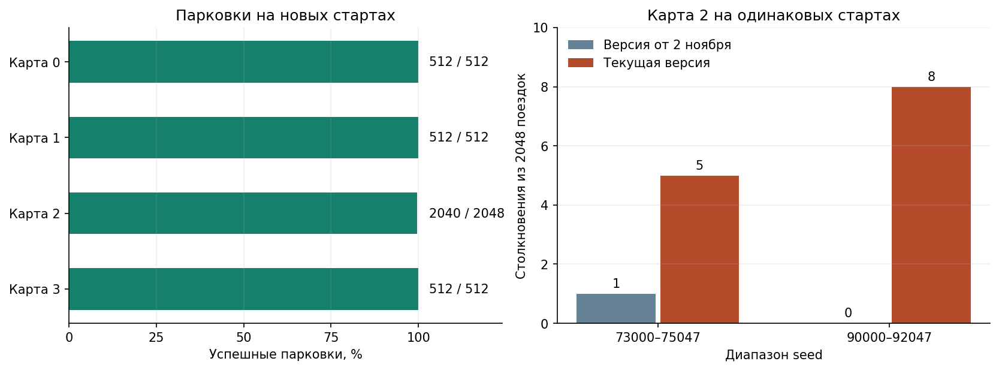

# Assignment 2 — PPO для робо-такси

**Автор** — Карим Хабибрахманов / Karim Khabibrakhmanov<br>
**Курс** — [F26] Introduction to Adaptive and Efficient Machine Learning, Innopolis

В среде из Assignment 1 обучены четыре политики PPO, по одной на карту. Каждая управляет газом, тормозом и рулём по 70 числам наблюдения. Успех засчитывается, когда машина останавливается у цели без столкновения. [Отчёт](REPORT.md) · [Видео](artifacts/demo.mp4) · [Артефакты и веса](artifacts/)

## Результаты

На новых стартах обученные водители припарковались в **3 576 из 3 584** поездок. Все восемь столкновений пришлись на карту 2. Планировки при этой проверке фиксированы. [Условия и результаты проверки](REPORT.md#results)



| Что посмотреть | Где найти |
| --- | --- |
| Как PPO собирает опыт и обновляет сети | [Схема одного обновления](REPORT.md#ppo-training) |
| Что дали изменение награды, перенос весов и частота управления | [Разбор экспериментов](REPORT.md#experiments) |
| Как шло дообучение карт 1 и 2 | [График по журналам обучения](REPORT.md#finetuning) |
| Как готовые модели ведут себя на новой планировке | [Карта 4 и проверка переноса](artifacts/map4_validation/README.md) |
| Что измерил бенчмарк JAX | [Производительность](REPORT.md#performance) |
| Как повторить запуск, тесты и обучение | [Команды воспроизведения](REPORT.md#reproduce) |
| Какой файл весов соответствует каждой карте | [Таблица моделей и метаданных](artifacts/README.md#weights) |

## Быстрый запуск

Из каталога `assignment-2` с Python 3.12. Пример запускает готового водителя на карте 2.

```bash
python3.12 -m venv .venv
source .venv/bin/activate
python -m pip install -r requirements-lock.txt
python src/play.py --checkpoint artifacts/ppo_v2_map2_rechecked/checkpoint.npz
```

Под Windows используйте команды из отчёта. Для запуска без окна добавьте `--headless`. [Команды для Windows и проверок](REPORT.md#reproduce) · [CI на Ubuntu и Windows](https://github.com/Karimkhab/adaptive-and-efficient-ml/actions/runs/42496985643)
