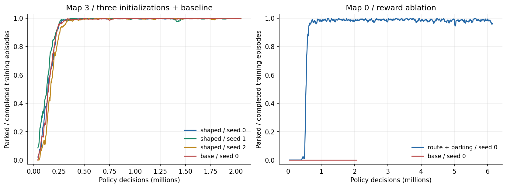
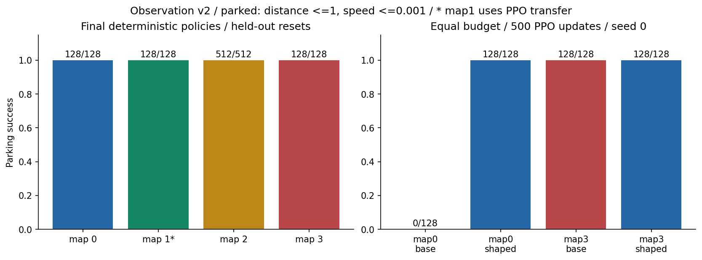
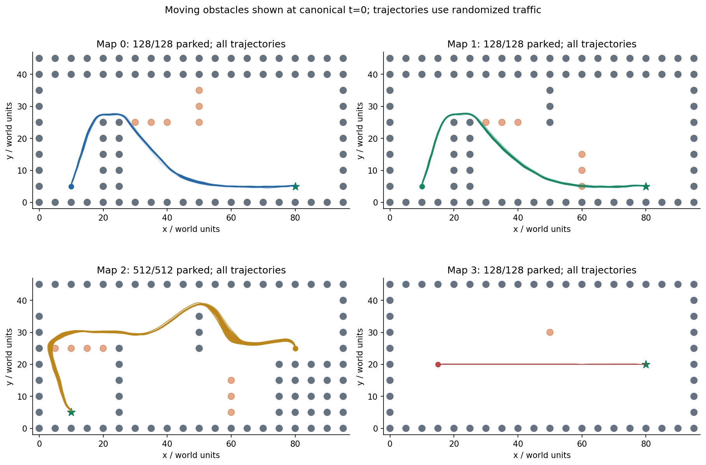

# Assignment 2 — обучение робо-такси с PPO

**Автор:** Карим Хабибрахманов / Karim Khabibrakhmanov  
**Курс:** [F26] Introduction to Adaptive and Efficient Machine Learning, Innopolis  
**Измерения:** 1–2 ноября 2026, macOS arm64, Python 3.12.15, JAX 0.6.2 CPU

## Результат и постановка

Задача — обучить робо-такси добираться до цели и останавливаться, используя
RL. Ниже отделены обучающая статистика, проверка замороженных моделей на новых
начальных условиях и перенос между картами. Используются отдельные политики
для четырёх фиксированных карт. На map1 применён перенос весов, подробно ниже.
Карты 0–2 взяты из выданной заготовки, map3 добавлена в A1 как отдельный сценарий.

Основа — опубликованная A1 на коммите
[`9f015e2`](https://github.com/Karimkhab/adaptive-and-efficient-ml/commit/9f015e2cbadbfb24ea54a894d8db3e4b552c0554).
Копия физики в `src/env/` не изменена: kinematic bicycle, продольное сопротивление,
ускорение/тормоз и угол руля, 30 физических шагов/с, радиус объекта 1, клетка 5.
Предел скорости 5; заднего хода и бокового скольжения нет. Трафик кинематический,
с разворотами перед препятствиями. Успех требует расстояния ≤1 и скорости
≤0.001 без столкновения. Скорость не обнуляется специальным кодом: модель
должна выбрать торможение обычным действием. Лимит — 3000 шагов / 100 с.

Перед обучением повторно проверены **41 тест и 32/32 сценария A1**. Все 43 записи
SHA-256 manifest сошлись; Git blob `robotaxi.py` совпал с удалённым коммитом.
[Успешный Linux/Windows CI A1](https://github.com/Karimkhab/adaptive-and-efficient-ml/actions/runs/41313584149)
подтверждён через API. Это проверки среды и эвристического демо, не оценка PPO.
Сохранённые доказательства находятся в `artifacts/a1_audit/`.

## Что видит модель

Наблюдение v2: **70 float32** — нормированная скорость (1), локальный вектор
цели (2), локальное направление навигационного маршрута (2), расстояние до
маршрута (1), дальности 32 лучей и 32 радиальные скорости сближения. Поле зрения
π, дальность 12. Перед MLP компоненты вектора цели умножаются на 20, затем
все признаки ограничиваются диапазоном [-5,5]. Это фиксированное масштабирование,
оно одинаково при обучении и inference; статистики теста не используются.

Вход — наблюдение с датчиками и навигационной подсказкой среды, а не изображение.
Навигационная подсказка уже есть в A1 и использует статическую карту.
Actor и critic не получают `TaxiState`, полные координаты/скорости всех объектов,
экспертные действия или прогноз трафика. Единственный интерфейс inference
`Policy(observation_vector)` возвращает пару в [-1,1]. Эвристический контроллер
A1 сохранён для аудита, но не вызывается при сборе PPO-данных или управлении
обученным агентом. Обучения по экспертным траекториям здесь нет.

## PPO и обработка эпизодов

Actor и critic — отдельные MLP 64×64 с tanh. Actor выдаёт среднее двухмерной
Normal и обучаемый log standard deviation; действие — tanh от выборки Normal.
Log probability учитывает Jacobian этого преобразования. При оценке deterministic
используется tanh среднего, при stochastic — выборка из обученного распределения.
Общее число обучаемых параметров: 17605.

Один rollout: 32 среды ×128 решений =4096 переходов. При обучении действие удерживается
6 физических шагов (0.2 с); при done повтор прекращает приносить награду и
менять состояние. Вознаграждения физических шагов суммируются, для обучения
масштабируются на 0.05. В отчёте return всегда без масштабирования.
В `training.csv` поля reward/episode return относятся к обучающей награде с
добавками; численные таблицы качества ниже используют raw return из evaluation.
В финальном inference map2 решение обновляется каждый физический шаг (30 Гц),
у остальных моделей — каждые шесть шагов (5 Гц). `repeat=6` в metadata означает
частоту обучения, `inference_repeat=1` — частоту замкнутого управления map2.
Фильтр или эксперт не подменяют действия обученного actor.

Для оценки преимущества используется GAE: delta = r + gamma·V(next)·(1-terminated)
−V(current), A = delta + gamma·lambda·(1-done)·A(next). gamma=0.99 на решение,
lambda=0.95. Collision/goal — истинное завершение, там bootstrap нулевой.
Time limit — truncated: bootstrap берётся по последнему наблюдению **до reset**,
но цепочка GAE через reset всё равно обрывается. Так новый эпизод не подменяет
оценку последнего состояния старого.

Обновление PPO минимизирует отрицательный clipped surrogate с clip=0.2,
половину critic loss и exploration term. Преимущества нормируются по rollout.
Critic loss — половина MSE к GAE-return; его коэффициент в общем loss 0.5.
Adam: learning rate 3e-4, epsilon 1e-5; 4 epochs ×4 minibatches по 1024,
global gradient norm clipping 0.5. Exploration coefficient 0.001 умножается
на энтропию **латентной Normal** — это proxy, а не энтропия после tanh.
Value clipping, replay buffer, imitation learning и safety override не используются.

## Награда и эксперименты

Исходная награда A1 за физический шаг: уменьшение евклидова расстояния до цели
−0.1·dt +100 за парковку −100 за collision. Baseline PPO обучается только на ней.
Во втором варианте евклидов прогресс заменён прогрессом вдоль фиксированного
начального маршрута. Потенциал равен минус сумме оставшейся длины ломаной и
расстояния до неё; используется разность потенциалов. Дополнительно вычитается
`0.1 * (speed - desired_speed)^2 * executed_seconds`, где desired speed =
`min(4, sqrt(3 * max(goal_distance - 0.3, 0)))`. Это плотная обучающая подсказка
для движения и торможения. Collision/goal/time не меняются. Поскольку в разности
потенциалов нет gamma, сохранение оптимальной политики discounted MDP не утверждается.
Все frozen evaluation, видео и сравнения return используют **исходную** награду.

Сравнение ниже меняет сразу маршрутную и скоростную добавки. Оно не позволяет
приписать эффект одной из них. Бюджет пары одинаков: seed0, 500 PPO updates,
2 048 000 решений, одна и та же версия среды и распределение reset.

| Карта | Обучающая награда | Парковки /128 | Collision | Timeout | Raw return |
| --- | --- | ---: | ---: | ---: | ---: |
| 0 | base | 0/128 | 0 | 128 | -10.04 |
| 0 | shaped500 | 128/128 | 0 | 0 | 167.63 |
| 3 | base | 128/128 | 0 | 0 | 163.42 |
| 3 | shaped500 | 128/128 | 0 | 0 | 163.16 |

На map1 запуск с нуля не дал устойчивого решения. Поэтому отдельно проверен
перенос PPO-весов с map0 после 500 updates и ещё 1000 updates на map1. Это
дополнительный бюджет/предобучение, а не честная пара с тем же числом данных.
Исходный неудачный запуск и его frozen результат сохранены. Данные теста не
использовались для выбора: решение о переносе принято по обучающему журналу,
промежуточные проверки разработки — reset seeds 10000–10063.

| Запуск | Updates | Решения | Реальные физические переходы | Цикл обучения, с |
| --- | ---: | ---: | ---: | ---: |
| ppo_v2_base_map0_seed0 | 500 | 2,048,000 | 12,287,948 | 322.6 |
| ppo_v2_base_map3_seed0 | 500 | 2,048,000 | 12,228,145 | 176.5 |
| ppo_v2_map0_seed0 | 1500 | 6,144,000 | 36,737,794 | 961.9 |
| ppo_v2_map1_seed0 | 1200 | 4,915,200 | 29,489,856 | 801.0 |
| ppo_v2_map1_transfer_seed0 | 1000 | 4,096,000 | 24,483,949 | 646.3 |
| ppo_v2_map2_safe_a | 800 | 3,276,800 | 19,604,611 | 536.0 |
| ppo_v2_map2_safe_b | 800 | 3,276,800 | 19,603,240 | 536.7 |
| ppo_v2_map2_seed0 | 1600 | 6,553,600 | 39,229,987 | 1065.9 |
| ppo_v2_map3_seed0 | 1000 | 4,096,000 | 24,456,233 | 338.6 |
| ppo_v2_map3_seed1 | 500 | 2,048,000 | 12,228,919 | 180.4 |
| ppo_v2_map3_seed2 | 500 | 2,048,000 | 12,229,931 | 180.8 |

Время — wall-clock цикла collect/update с его JIT, без установки, импортов и
создания среды/сети. Некоторые запуски шли параллельно, поэтому по этой колонке
нельзя сравнивать вычислительную эффективность наград. Для неё есть отдельный
бенчмарк ниже. Checkpoints — веса для inference; точный restart с состоянием
Adam/RNG/параллельных сред не реализован. Полное повторение идёт с начала.

## Замороженная оценка

Основная проверка карт 0/1/3: по 128 reset seeds 20000–20127. Для доработанной map2
используются 512 новых seeds 50000–50511, отложенных до выбора модели/частоты управления.
Прежние seeds 20000–20127 для map2 теперь регрессионные, не независимый тест. Reset
меняет heading равномерно в ±10°, начальную скорость [0,0.5], множитель скорости
трафика [0.8,1.2] и его фазу на 0–30 физических шагов. Позиция/цель/карта
фиксированы. Seed-списки совпадают у сравниваемых моделей. Это независимые
от обучения начальные условия в том же распределении, **не неизвестные карты**.

Каждый эпизод доводится до goal/collision/time limit без reset внутри оценки.
Проверяется, что исходы дают ровно N, успешные скорости/расстояния соблюдают
критерий, состояния конечны, а raw return совпадает с аналитической суммой
прогресса, времени и terminal bonus/penalty. Сохранены исходы и траектории
всех случаев, включая неудачи. Wilson 95% ниже описывает вариативность reset
для данного checkpoint; неопределённость обучения он не покрывает.

| Карта | Парковки | Collision | Timeout | Wilson 95% | Raw return mean | Время симуляции mean, с |
| --- | ---: | ---: | ---: | --- | ---: | ---: |
| 0 | 128/128 | 0 | 0 | 97.1–100.0% | 167.59 | 20.22 |
| 1 | 128/128 | 0 | 0 | 97.1–100.0% | 167.67 | 20.12 |
| 2 | 512/512 | 0 | 0 | 99.3–100.0% | 169.54 | 27.76 |
| 3 | 128/128 | 0 | 0 | 97.1–100.0% | 163.31 | 14.33 |

Дополнительные срезы: stochastic actions, восемь вариантов A1 на карту, random
uniform actions, необученная сеть и zero-shot перенос модели map3. Варианты A1
уже использовались при разработке самой среды; их нельзя считать независимой
оценкой A1. Здесь они служат проверкой RL на явных граничных условиях.

| Срез | Парковки | Collision | Timeout |
| --- | ---: | ---: | ---: |
| map0_stochastic | 127/128 | 1 | 0 |
| map0_variants | 8/8 | 0 | 0 |
| map0_untrained | 0/128 | 0 | 128 |
| map0_random | 0/128 | 108 | 20 |
| map1_stochastic | 127/128 | 1 | 0 |
| map1_variants | 8/8 | 0 | 0 |
| map1_untrained | 0/128 | 0 | 128 |
| map1_random | 0/128 | 108 | 20 |
| map2_stochastic | 512/512 | 0 | 0 |
| map2_variants | 8/8 | 0 | 0 |
| map2_untrained | 0/128 | 0 | 128 |
| map2_random | 0/128 | 0 | 128 |
| map3_stochastic | 128/128 | 0 | 0 |
| map3_variants | 8/8 | 0 | 0 |
| map3_untrained | 0/128 | 0 | 128 |
| map3_random | 0/128 | 45 | 83 |
| map1_scratch | 0/128 | 0 | 128 |
| zero_shot_map0 | 0/128 | 81 | 47 |
| zero_shot_map1 | 0/128 | 81 | 47 |
| zero_shot_map2 | 0/128 | 0 | 128 |

Чувствительность к обучающему seed проверена на map3 при одинаковых 500 updates:

| Seed | Парковки /128 | Collision | Timeout |
| --- | ---: | ---: | ---: |
| 0 | 128/128 | 0 | 0 |
| 1 | 128/128 | 0 | 0 |
| 2 | 128/128 | 0 | 0 |

Списки reset одинаковы: 384 результата трёх моделей не трактуются как 384
независимых новых мира. Для остальных карт нет многосидовых реплик одинаковой
постановки; два safety-кандидата map2 различаются настройками и такими репликами
не являются. Обобщать на произвольную инициализацию и любую карту нельзя.
Все срезы показаны, включая проигрыши; поправки на множество гипотез не делались,
поэтому вторичные сравнения описательные. Гипотеза о хорошем универсальном
zero-shot агенте проверяется отдельно и не подменяет результат по своим картам.

## Доработка карты 2: скорость, зазор и частота обратной связи

Прежняя модель дала 124/128 парковок: два удара о статическую стену и два о
трафик на одном левом повороте. Скорости в этих столкновениях 3.54–4.11; газ
оставался положительным. Полные контексты и последние 120 шагов — в
`artifacts/map2_diagnosis/`. Эти случаи после обнаружения считаются регрессией,
а не независимым тестом. Исходная оценка сохранена в `evaluation_initial/`.

Проверены два варианта дообучения исходных весов map2 после 1600 updates.
A: cruise2.5, speed-cost1, clearance-cost4, margin1, seed0. B: cruise3,
speed-cost0.75, clearance-cost6, margin1.25, seed1. У обоих Adam1e-4 и
entropy-coefficient0.0, по 800 дополнительных updates. Штраф за скорость
использует target `min(cruise, sqrt(3*max(goal_distance-.3,0)),
sqrt(4*max(clearance-.5,0)))`; штраф за малый зазор —
`clearance_cost * max(margin-clearance,0)^2 * executed_seconds`.
Плотная награда рассчитывается средой по геометрии во время обучения;
runtime actor по-прежнему получает только 70 наблюдений. Ни физика, ни
terminal-критерий, ни действия actor на inference не корректируются экспертом.

| Кандидат / snapshot | Dev парковки | Collision | Timeout |
| --- | ---: | ---: | ---: |
| a / 200 | 126/128 | 2 | 0 |
| a / 600 | 486/512 | 26 | 0 |
| a / 800 | 504/512 | 2 | 6 |
| b / 200 | 121/128 | 7 | 0 |
| b / 600 | 509/512 | 2 | 1 |
| b / 800 | 499/512 | 13 | 0 |

Для B600 отдельно изменена только частота применения тех же весов. Действие
раз в 6 физических шагов даёт 509/512 на dev, раз в 3 —511/512, каждый шаг —512/512.
Таким образом, одной поправки reward оказалось мало: обратная связь 5 Гц
запаздывала на тесном повороте. Финальный экспорт содержит те же веса B600 и
явное `inference_repeat=1` (30 Гц); обучение шло с `repeat=6` (5 Гц).
Это изменение частоты исполнения обученной политики, не safety override.
Выбран snapshot600, а не последний 800; критерий выбора — dev, не новый тест.
Старые 128 случаев и 8 endpoint cases также пройдены полностью до открытия нового теста.

Свежий набор 512 стартов (seeds 50000–50511) был зафиксирован в протоколе до выбора
модели и до его просмотра. Его результаты:

| Frozen вариант | Парковки | Collision | Timeout | Минимальный зазор |
| --- | ---: | ---: | ---: | ---: |
| map2_before_safety_fresh | 487/512 | 21 | 4 | -0.054 |
| map2_final | 512/512 | 0 | 0 | 0.364 |
| map2_stochastic | 512/512 | 0 | 0 | 0.236 |

Дообучение имеет дополнительный бюджет, а reward/частота менялись совместно;
всю разницу с исходной моделью нельзя приписать одному коэффициенту. Частотная
абляция внутри B600 изолирована, но выполнена на dev. Новый тест даёт ограниченную
эмпирическую проверку; ноль столкновений не означает доказанную безопасность
на всех возможных стартах. Начальные позиции/цель фиксированы, меняются курс,
начальная скорость, темп и фаза трафика. Это не тест неизвестных карт.

## Вычислительные оптимизации

`vmap` ведёт параллельные среды одной карты; `lax.scan` собирает rollout,
повтор действий, обратный GAE и epochs/minibatches. `jit` компилирует целые
фрагменты; во время rollout нет Python-проверок на каждом физическом шаге и
рендеринга. Сеть мала, данные float32 и остаются в JAX. Разные карты обучаются
раздельно, поскольку формы массивов препятствий различаются. Action repeat
сокращает частоту решений, но меняет задачу управления; это не эквивалентный
бенчмарк ускорения. Реальное число физических переходов учитывает ранние done.

Отдельный CPU-бенчмарк: 16 одинаковых сред ×64 шага, repeat=1 —1024 перехода.
Одинаковые действия/начальные состояния, конечные состояния сверены до 2e-5.
Каждый вариант прогрет; пять повторов, медиана; `block_until_ready` завершает
измеряемую работу до остановки таймера. Cold включает компиляцию и исполнение,
а не чистое время компилятора. Это изолированный workload, не скорость полного PPO.

| Вариант | Cold, с | Warm median, с | Физических переходов/с |
| --- | ---: | ---: | ---: |
| python_serial_jit_step | 0.2901 | 0.01908 | 53,667 |
| python_loop_vmap | 0.3116 | 0.04023 | 25,452 |
| jit_scan_vmap | 0.1364 | 0.00288 | 355,463 |

В этом workload объединённый `jit+scan+vmap` быстрее serial Python-loop с JIT-step в **6.62 раза**. Сам по себе vmap не объявляется гарантией ускорения: в таблице показан фактический результат каждого варианта.

Численная проверка raw return учитывает накопление float32-ошибок: у почти
неподвижной необученной сети за 3000 шагов наблюдалось расхождение 0.023. Допуск
контрольной суммы ограничен четырьмя ULP расстояния на выполненный шаг. Это
не меняет награды или строгие критерии парковки/столкновения; для финальной
map2 ошибка реконструкции меньше 0.0003. Расчёт сохранён в return_precision.json.

## Трудности, решения и пределы

Первый локальный пилот оказался на прежней среде с 38 признаками, клеткой 3 и
успехом при проезде через цель. После обновления A1 его результаты выведены из
итогового комплекта: обучение полностью повторено на контракте v2 с парковкой.
Иначе хорошие числа отвечали бы другой задаче. Старые результаты не используются
как baseline новой среды.

Вторая трудность — reward и exploration около стены/при торможении. Проверены
исходная и более плотная награда при одинаковом бюджете, а не просто выбран
удачный rollout. На map1 понадобился перенос весов с освоенной карты; его
дополнительные данные и неудача scratch явно сохранены. На сложных сценах и
при stochastic действиях результат ограничен показанной таблицей.

Третья — отличить timeout от истинного terminal и не использовать начальное
наблюдение нового эпизода для bootstrap. Это проверено тестами GAE на вручную
посчитанных примерах, смешанными пакетными завершениями и raw/macro эквивалентностью.
Проверка градиентов подтверждает конечные ненулевые значения и реальное обновление
actor. Checkpoint roundtrip сверяется точно; загрузчик отвергает старый контракт.

Наблюдение не делает весь мир полностью наблюдаемым: у датчиков ограничены поле
зрения/дальность. Успех на четырёх известных картах не доказывает универсальную
безопасность. В A1 есть регрессионный сценарий с зазором около 0.0067; утверждения
об устойчивости этой геометрии к произвольному шуму не делаются. Оптимальность
политики не установлена и по сохранённым условиям A2 не требуется.

## Проверки и соответствие условиям

Результат текущих тестов: **51 passed in 26.04s**. Проверка зависимостей — `pip check`.

| Требование | Реализация / доказательство | Статус |
| --- | --- | --- |
| RL в своей среде, цель | PPO `src/train.py`, 4 карты, parking/collision/timeout по всем эпизодам | Проверено локально |
| Понимание RL и алгоритма | Постановка, actor/critic, GAE, clipping, reward и ограничения выше | Описано |
| Вычислительные оптимизации | jit/vmap/scan, float32, repeat; равная работа и warm/cold timing | Измерено |
| Код и checkpoint | `src/`, `.npz` + `.json` для каждой модели, configs/CSV | На месте |
| Видео | `artifacts/demo.mp4`, реальные neural rollouts, pixel renderer A1 | Записано |
| Отчёт с автором и трудностями | Этот документ, фактические эксперименты и ограничения | На месте |
| Воспроизведение | README: установка, inference, evaluation, обучение с нуля | Команды приведены |

### Аудит методологии

| Критерий | Доказательство | Вердикт |
| --- | --- | --- |
| Арифметика и знаменатели | Каждый эпизод имеет ровно один исход; return восстановлен из расстояния/времени/terminal; полный JSON доступен | Проверено |
| Одинаковость условий | Reward-пары: seed0, 500 updates, 32×128 решений, одна среда v2 и одни test reset seeds | Проверено для пары; transfer отдельно |
| Шум оценки | Wilson для N=128; три training seeds только на map3 | Оговорка: не все источники неопределённости |
| Защитные срезы | Stochastic, 32 endpoint cases, baseline и zero-shot показаны полностью | Проверено; неудачи видны |
| Множественные сравнения | Все 35 named результатов сохранены; вторичные сравнения описательные | Оговорка: нет multiple-testing correction |
| Train/dev/test | Training RNG seeds 0/1/2; dev10000–10511 для map2; final20000–20127 (карты 0/1/3) и 50000–50511 (map2); карты при обучении известны | Разделено по reset, не по карте |
| Гипотеза → данные → вывод | Reward-пара, scratch map1 и PPO-transfer имеют отдельные configs, checkpoints, CSV и frozen исходы | Прослеживается |
| Причинность | Пара меняет пакет route+parking; результат transfer не приписан одному изменению reward | Ограничена именно проверенным пакетом |
| Альтернативы | Есть random/untrained/base, разные seeds map3; для сложных карт нет много-seed вывода | Оговорка: ограниченный бюджет реплик |
| Выборка | По 128 стартов карт 0/1/3 и 512 стартов map2 на известных картах; 8 endpoint cases отдельно | Масштаб вывода ограничен |
| Код доступен | PPO, sampler, reward, inference, evaluation, benchmark и report generator в src/ | На месте |
| Применимость | Готовые checkpoints и воспроизведение; перенос map1 указан как отдельная стратегия | Соответствует A2 |
| Формулы и граничные случаи | Ручные GAE-примеры, terminal/timeout, action repeat, повреждённый checkpoint, старый контракт | Покрыто тестами |
| Join / уникальность | Join нет; имена 35 результатов уникальны, N исходов на N reset | Проверено генератором |
| Повторный запуск | Новый training output обязателен; evaluation воспроизводит фиксированные checkpoints | Данные обучения защищены |
| Контракт | Физика byte-identical A1; actor принимает 70 наблюдений; терминал требует остановки | Проверено |

Методологическая проверка: формулы и знаменатели восстановлены из кода/JSON;
в парах reward одинаковы seed/бюджет/среда; transfer имеет другой бюджет и так
подписан; validation отделена от frozen test; все защитные срезы и неудачи
сохранены. Join таблиц не применяется: один named результат на эксперимент,
один исход на reset. Архив и manifest отделены от venv/кешей. Полной числовой
рубрики на 25 баллов в сохранённых условиях нет, поэтому полный балл не обещается.

Проверены macOS arm64 и настоящий нативный CI A2 на Ubuntu24.04/Windows2022.
[CI-прогон](https://github.com/Karimkhab/adaptive-and-efficient-ml/actions/runs/41421653274) для кода `c3832eec3a43d8528ff632a9044dce411e9fed5d` успешен на обеих ОС.
На каждой ОС выполнены pytest, отдельный update обучения, quality gate готовых моделей,
набор всех срезов с уменьшенным CI-бюджетом и запись/декодирование видео.
Доказательства — в artifacts/ci_results.json и ci_native/.
Оконный интерфейс Linux/Windows вручную не проверялся.
Для зафиксированных зависимостей A2 успешно выполнен pip dry-run с бинарными
пакетами Python3.12 для Windows x86-64 и Linux x86-64; это проверка доступности
пакетов, не их исполнения. JSON и журналы сохранены в artifacts/.
Публикация main/Submission поручена пользователем 2 ноября. Сообщение преподавателю не отправлялось.

## Воспроизведение и источники

Пошаговые команды — в [README](README.md). Коротко: Python3.12 → `pip install -r
requirements-lock.txt` → `pytest` → `evaluation_suite.py` → `benchmark.py` →
`charts.py` → `make_rl_video.py` → `report.py`. Для обучения заново — `train_all.py`
в новый каталог; для одного эксперимента — `train.py`. Checkpoints хранят weights
и configuration; побитовый restart Adam/состояний среды не заявлен.

- Условия: Assignments.pdf преподавателя, 30.09.2026, [сообщение курса](https://t.me/c/3789089672/80).
  Состав требований сохранён в контексте проекта; PDF не содержит подробной
  разбалловки внутри A2. JAX рекомендован, PyTorch разрешён; PPO — допустимый выбор.
- Среда A1: [проверенный коммит](https://github.com/Karimkhab/adaptive-and-efficient-ml/tree/9f015e2cbadbfb24ea54a894d8db3e4b552c0554/assignment-1).
- Заготовка курса: [InnoRL/IAEML-assignment](https://github.com/InnoRL/IAEML-assignment).
- Schulman et al., [Proximal Policy Optimization Algorithms](https://arxiv.org/abs/1707.06347).
- Schulman et al., [Generalized Advantage Estimation](https://arxiv.org/abs/1506.02438).
- JAX: [JIT](https://docs.jax.dev/en/latest/201/jit.html), [vmap/grad](https://docs.jax.dev/en/latest/101/transformations.html),
  [измерение производительности](https://docs.jax.dev/en/latest/201/profiling.html).

Использована AI-помощь в коде и анализе. Раздел о трудностях описывает реальные
проверки и изменения; личные мысли или несуществующий опыт студента не сочинялись.

## Подтверждённые артефакты нативного CI A2

| ОС | Python | Тесты | Map2 parking | Endpoints | Обучение | Видео | Срезы / эпизоды |
| --- | --- | --- | --- | --- | --- | --- | --- |
| ubuntu-24.04 | 3.12.15 | 51/51, без пропусков | 128/128,0 collision | 8/8 | 1 update, actor изменился | 2 парковки; 3 декодированных кадра | 35 / 612 |
| windows-2022 | 3.12.10 | 51/51, без пропусков | 128/128,0 collision | 8/8 | 1 update, actor изменился | 2 парковки; 3 декодированных кадра | 35 / 612 |

Первый запуск не исполнял runners из-за YAML-экранирования `:all:`. Ошибка
исправлена отдельным коммитом до успешного прогона; её история сохранена в ci_results.json.
