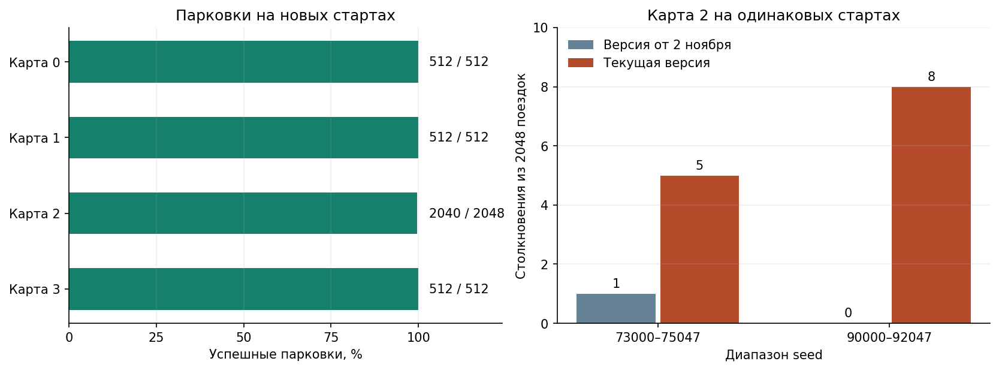
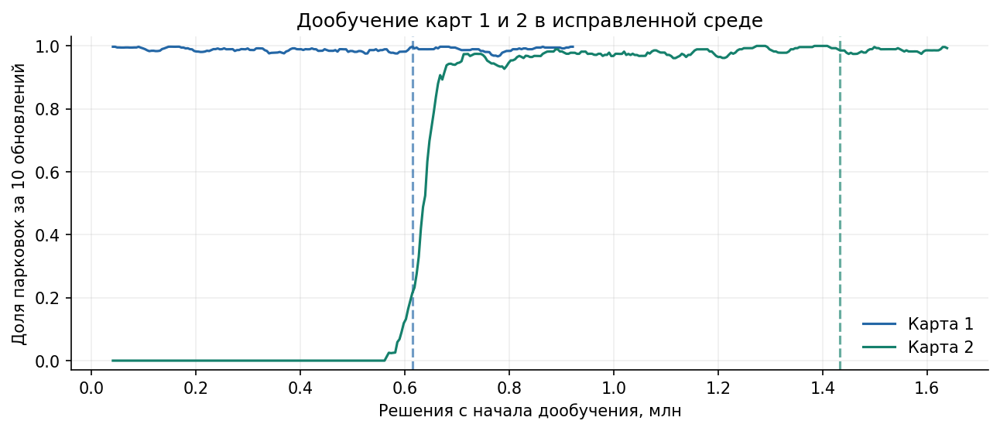
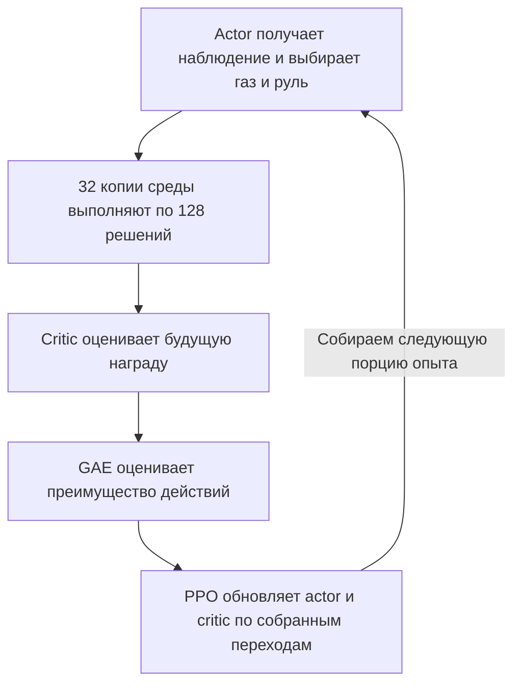

# Assignment 2 — как робо-такси училось доезжать до цели и останавливаться

**Автор:** Карим Хабибрахманов / Karim Khabibrakhmanov<br>
**Курс:** Introduction to Adaptive and Efficient Machine Learning, Innopolis, осень 2026<br>
**Эксперименты:** 1–2 и 7–8 ноября 2026

В первой работе был реализован симулятор автомобиля. Во второй работе в этом симуляторе обучены нейросети, которые управляют газом, тормозом и рулём.

<a name="results"></a>

## Повторная проверка после исправлений 8 ноября

Модели на всех четырёх картах повторили **896/896 парковок** на прежних стартах и в `float32`, и в `float64`. На новом наборе с уже выбранными весами получено **3 576/3 584**. Восемь столкновений пришлись на карту 2.

| Карта | Прежние старты, float32 | Прежние старты, float64 | Новые старты, float32 | Столкновения на новых стартах | Таймауты на новых стартах |
| --- | ---: | ---: | ---: | ---: | ---: |
| 0 | 128/128 | 128/128 | 512/512 | 0 | 0 |
| 1 | 128/128 | 128/128 | 512/512 | 0 | 0 |
| 2 | 512/512 | 512/512 | 2040/2048 | 8 | 0 |
| 3 | 128/128 | 128/128 | 512/512 | 0 | 0 |

Изменения начального курса, скорости и трафика остались в прежних диапазонах. Для новых поездок использованы seed 81000–81511 на картах 0 и 3, 93000–93511 на карте 1 и 90000–92047 на карте 2. [Исходы по каждому старту](artifacts/recheck/summary.json).

При попарной проверке на карте 2 у версии от 2 ноября и исправленной версии использовались одинаковые старты. На seed 73000–75047 получено **2047/2048 и 2043/2048**, на seed 90000–92047 — **2048/2048 и 2040/2048** соответственно. Здесь сравниваются полные версии, то есть и симулятор, и политика. На обоих наборах у исправленной версии больше столкновений, хотя она проходит известный сбой 74537.



Слева показаны парковки текущих водителей. Справа каждая пара столбцов сравнивает две версии на одном наборе из 2 048 стартов карты 2.

Край карты теперь участвует в показаниях лучей и в штрафе за малый зазор. Вместе с изменением торможения это повлияло на старую модель карты 2. На диагностических 128 стартах в исправленной среде она дала одно столкновение и 127 таймаутов. В одной из таких поездок машина остановилась примерно в 2.76 единицы от цели при радиусе парковки 1.

В старой маршрутной награде ближайшая точка могла перескочить на другую ветку маршрута. На карте 2 из-за этого сдвиг на 0.002 давал около +57 за прогресс. Теперь для каждой проекции считается непрерывная стоимость пути с доплатой за удаление от маршрута, затем берётся минимум. На том же сдвиге добавка за прогресс составила 0.034. [Функция награды](src/rl_env.py) · [Тест на этот случай](tests/test_ppo.py).

Для карты 2 взяты веса до первого safety-дообучения и выполнено 400 обновлений в исправленной среде. Выбраны веса после 350 обновлений, управление через четыре физических шага (7.5 Гц при использовании, 5 Гц при обучении). Для карты 1 из 225 обновлений выбраны веса после 150, управление через три шага (10 Гц при использовании, 5 Гц при обучении). На картах 0 и 3 оставлены проверенные веса. На карте 2 воспроизводившееся столкновение на seed 74537 сменилось парковкой в обоих режимах точности. [Конфиг карты 1](artifacts/ppo_v2_map1_rechecked/checkpoint.json) · [Конфиг карты 2](artifacts/ppo_v2_map2_rechecked/checkpoint.json).

<a name="finetuning"></a>

### Как шло дообучение



Линии показывают долю парковок среди поездок, завершившихся за последние десять обновлений PPO. Пунктир отмечает выбранные веса после 150 обновлений для карты 1 и 350 для карты 2. Кривые описывают сбор опыта во время обучения. Результаты выбранных весов на отдельных стартах приведены в таблице выше. [Журнал карты 1](artifacts/ppo_v2_map1_rechecked/training.csv) · [Журнал карты 2](artifacts/ppo_v2_map2_rechecked/training.csv)

При случайной выборке действий на прежних стартах карта 0 дала 127/128, карты 1 и 3 по 128/128, карта 2 дала 506/512 с пятью столкновениями и одним таймаутом. Основной режим использует детерминированный выход actor. На macOS прошли 56 тестов в обоих режимах точности, проверено одно обновление PPO и декодировано новое видео четырёх парковок. [Тесты](artifacts/tests.txt) · [Локальная проверка CI](artifacts/recheck/ci-local.json) · [Сверка точности](artifacts/precision_comparison.json).

<a name="map4-experiment"></a>

**Дополнительный эксперимент.** Чтобы проверить перенос без дообучения, запустили готовые модели на карте 4 с объездом островка в двух вариантах: с поперечным трафиком и без него. Демонстрационный водитель припарковался в 33 из 33 заездов в каждом варианте. PPO карты 3 дала 128 из 128 парковок на своей карте, а на каждом варианте карты 4 столкнулась во всех 128 заездах. [Карты и результаты всех четырёх моделей](artifacts/map4_validation/README.md)

Разделы об исходных экспериментах ниже сохраняют результаты от 2 ноября и объясняют, как выбирались алгоритм, награда и бюджет обучения.

## 1. Задача: закончить поездку парковкой

Автомобиль должен объехать неподвижные препятствия и движущийся трафик, добраться до заданной точки и остановиться рядом с ней.

Задание A2 требует провести RL-эксперименты, объяснить выбранную модель и ускорить вычисления. Найти оптимального водителя не требуется. Результат должен воспроизводиться по коду, сохранённым весам и инструкции.

Поездка считается успешной, если одновременно выполнены три условия:

- Расстояние от центра машины до цели — не больше 1 условной единицы.
- Скорость — не больше 0.001: практически полная остановка.
- Столкновений не было.

Проезд через цель на высокой скорости успехом не считается. На одну поездку отводится 100 секунд симуляции. Столкновение или истечение этого времени заканчивают поездку неудачей.

Карты 0, 1 и 2 взяты из заготовки преподавателя. Карта 3 — дополнительная открытая площадка с движущимся препятствием. Номера сохранены из кода, поэтому первая карта имеет номер 0.

В A2 используется та же физика, что и в [Assignment 1](https://github.com/Karimkhab/adaptive-and-efficient-ml/blob/Submission/assignment-1/REPORT.md): машина разгоняется, поворачивает на ходу и замедляется от сопротивления. Остановка достигается обычным торможением.

<a name="ppo-training"></a>

## 2. Как устроено обучение

Используется **обучение с подкреплением**: машина пробует действия, получает награду, а алгоритм меняет параметры нейросети, чтобы удачные действия встречались чаще.

Выбран **PPO**: он работает с непрерывными газом и рулём и сдерживает слишком резкие изменения поведения при одном обучающем обновлении. Реализация на JAX позволяет считать среду A1 и нейросеть вместе на CPU.

### Что получает нейросеть

Вход модели — 70 чисел:

- Текущая скорость машины.
- Направление и расстояние до цели относительно машины.
- Направление ближайшего участка маршрута и отклонение от него.
- Расстояния до препятствий по 32 лучам, расположенным вокруг машины.
- Проекции относительных скоростей на эти же лучи.

Маршрутная подсказка уже есть в A1. Модель учится вести машину вдоль маршрута, учитывать трафик и тормозить. Картинку из видео она не получает; экспертный контроллер A1 её действия не заменяет.

### Что означает одно обновление обучения



В основных запусках одно обновление использует **32 × 128 = 4096 решений**. Поездка может продолжаться между обновлениями. Actor выбирает действие из своего распределения, а среда возвращает награду, новое наблюдение и исход перехода. Вместе с переходом сохраняется `log_prob` — логарифм плотности выбранного действия по старой политике.

Critic оценивает будущую суммарную награду. GAE использует оценки critic и полученные награды, чтобы определить, насколько действие оказалось лучше или хуже ожидаемого. Затем PPO обновляет обе сети, ограничивая вклад слишком больших изменений вероятностей в целевую функцию actor. В основных запусках по одной порции опыта выполняются четыре прохода по четырём мини-пакетам. [Сбор опыта](src/train.py) · [Функция потерь и оптимизатор](src/ppo.py) · [Точные параметры и формулы](#ppo-details)

<a name="experiments"></a>

## 3. Что пришлось изменить по результатам экспериментов

### 3.1. Обход стены: награда за движение по маршруту

Исходная награда поощряла приближение к цели по прямой. При объезде стены сначала может потребоваться отдалиться от цели, поэтому подсказка противоречит нужному манёвру.

В улучшенном варианте поощряется продвижение по маршруту. Дополнительный штраф за неподходящую скорость поддерживает торможение перед целью.

Ниже сравниваются два запуска на карте 0. Им дали одинаковый бюджет — по 500 обновлений обучения. После этого каждую модель проверили на одних и тех же 128 условиях старта.

| Награда при обучении | Успешные парковки | Столкновения | Не успела за 100 секунд |
| --- | ---: | ---: | ---: |
| За приближение к цели по прямой | 0/128 | 0 | 128 |
| За продвижение по маршруту и подходящую скорость | 128/128 | 0 | 0 |

У исходной модели столкновений не было, но ни одна поездка не закончилась парковкой. Изменённая награда помогла получить работающий объезд. Проверялся совместный эффект двух подсказок; вклад каждой из них отдельно здесь не измерялся.

На простой открытой карте 3 оба варианта дали 128/128 парковок. Следовательно, новая награда оказалась полезной для сложного объезда, но не показала преимущества на каждой карте.


**Как читать график.** Горизонталь — количество решений при обучении. Вертикаль — доля парковок среди завершённых поездок за последние десять обновлений. Слева — независимые запуски и разные награды на открытой карте; справа — изменение награды на карте 0.

Таблица сравнивает первые 500 обновлений. На графике улучшенный запуск показан и после этого бюджета, поэтому его линия длиннее. Это обучающая статистика; итоговый тест приведён отдельно.

### 3.2. Карта 1: перенос уже освоенного управления

Обучение с нуля на карте 1 за 1200 обновлений дало 0/128 парковок. Поэтому следующий запуск начат с весов модели карты 0: 500 обновлений на карте 0, затем ещё 1000 на карте 1. Результат — 128/128 парковок.

Перенос проверял пользу уже освоенного управления. Он использовал дополнительный опыт с другой карты; бюджеты этих двух способов не равны.

### 3.3. Карта 2: безопасный поворот и своевременное управление

В первоначальной проверке карты 2 произошло четыре столкновения из 128 поездок. Два удара пришлись на стену, два — на движущийся трафик. Все они произошли на одном левом повороте, при скорости примерно 3.5–4.1 условной единицы в секунду.

Для исправления проверены два варианта дообучения с разными значениями параметров. Оба сочетали три изменения:

- Более низкая желаемая скорость.
- Штраф за малый зазор до препятствия.
- Дополнительное снижение желаемой скорости рядом с препятствием.

Одного изменения награды оказалось недостаточно. Поэтому отдельно проверена **частота управления**: как часто нейросеть получает обновлённое наблюдение и выбирает следующее действие.

В таблице используются одни и те же веса модели и одни и те же 512 проверочных стартов. Меняется только частота выбора действия.

| Частота управления | Сколько держится одно действие | Парковки | Столкновения | Не успела |
| --- | --- | ---: | ---: | ---: |
| 5 решений в секунду | 0.20 секунды | 509/512 | 2 | 1 |
| 10 решений в секунду | 0.10 секунды | 511/512 | 1 | 0 |
| 30 решений в секунду | 0.033 секунды | 512/512 | 0 | 0 |

При скорости около 4 за 0.2 секунды машина проезжает около 0.8 условной единицы. Для тесного поворота это существенное расстояние. Более частое управление позволило раньше реагировать на изменение положения машины.

Для карты 2 выбран режим 30 решений в секунду. У остальных моделей сохранён режим 5 решений в секунду. Обучение всех моделей шло с частотой 5 решений в секунду; изменение частоты при использовании модели записано отдельно в её настройках.

## 4. Когда прекращать обучение и какую версию сохранять

**Число обновлений задавалось заранее. Автоматической остановки по качеству в реализации нет.**

Для сравнения наград использован бюджет по 500 обновлений. Остальным базовым запускам были заданы бюджеты от 1000 до 1600 обновлений. Это вручную выбранные пределы экспериментов; минимально необходимое время обучения отдельно не искалось.

Например, улучшенная модель карты 0 уже после 500 обновлений дала 128/128 парковок, но основной запуск продолжался до своего лимита 1500. Необходимость именно 1500 обновлений отдельно не устанавливалась.

Во время запуска сохранялась версия сети каждые 50 обновлений. Такая сохранённая версия называется **checkpoint**. Благодаря этому можно использовать более раннюю модель, если продолжение обучения её ухудшило.

Показательный пример — дообучение карты 2. Оба кандидата обучались до 800 обновлений, но у выбранного кандидата версия после 600 работала лучше поздней версии:

| Сохранённая версия одного кандидата | Парковки на проверочных стартах | Столкновения | Не успела |
| --- | ---: | ---: | ---: |
| После 600 обновлений дообучения | 509/512 | 2 | 1 |
| После 800 обновлений дообучения | 499/512 | 13 | 0 |

В этом сравнении частота управления одинакова — 5 решений в секунду. Поэтому для дальнейшей проверки взяты веса после 600 обновлений. Затем на проверочной выборке выбран описанный выше режим управления 30 раз в секунду.

Эти 600 обновлений идут **после 1600 обновлений базового обучения** карты 2. Финальная модель не обучалась с нуля всего за 600 обновлений.

Чтобы выбор модели не подгонялся под итоговый результат, данные использовались в следующем порядке:

1. **Обучение:** поездки, по которым изменяются веса нейросети.
2. **Проверочная выборка:** отдельные старты для сравнения настроек, сохранённых версий и частоты управления.
3. **Итоговый тест:** новый набор стартов, открытый после фиксации выбранной модели и режима её использования.

Работа остановлена после выполнения критериев готовности: финальная модель паркуется на новом тесте, проходит граничные случаи и запускается на проверенных платформах. Поиск самого короткого обучения или оптимальной политики в эту работу не входил.

## 5. Итоговый тест исходной версии

В экспериментах 2 ноября для карт 0, 1 и 3 использовано по 128 тестовых стартов. Для доработанной карты 2 заранее отложено 512 новых стартов.

Между поездками менялись:

- Начальное направление машины: в пределах ±10°.
- Начальная скорость: от 0 до 0.5 условной единицы в секунду.
- Скорость трафика: от 80% до 120% исходной.
- Фаза движения трафика: сдвиг от 0 до 1 секунды.

**Планировки, начальные позиции машины и положение цели оставались фиксированными.** Это проверка новых условий поездки на известных картах.

| Карта | Парковки / все поездки | Столкновения | Не успела за 100 секунд | Средняя длительность успешной поездки |
| --- | ---: | ---: | ---: | ---: |
| 0 — объезд стены | 128/128 | 0 | 0 | 20.22 с |
| 1 — дополнительное препятствие | 128/128 | 0 | 0 | 20.12 с |
| 2 — сложный поворот с трафиком | 512/512 | 0 | 0 | 27.76 с |
| 3 — открытая площадка | 128/128 | 0 | 0 | 14.33 с |

Например, строка «512/512» означает 512 отдельных законченных поездок, каждая из которых завершилась остановкой в цели без столкновения.

Для каждой карты используется своя модель. Перенос модели открытой площадки на остальные карты без дообучения не дал успешных поездок. Поэтому результат работы относится к четырём освоенным сценам, а не к универсальному водителю для любой новой карты.


Левая часть графика показывает итоговые модели. Правая — сравнение наград при одинаковых 500 обновлениях обучения. Подпись над столбцом показывает число парковок и число проверенных поездок.


На последнем графике каждая линия — одна поездка. Движущиеся препятствия нарисованы в исходном положении, хотя при проверке их фаза и скорость менялись. Полные исходы всех поездок сохранены в [результатах оценки](artifacts/evaluation/summary.json).

Ноль столкновений на этом наборе — измеренный результат. Он не доказывает безопасность при любых скоростях, новых планировках или произвольных начальных позициях.

**Проверка исходной версии в `float64`.** Первоначальное обучение и оценка выполнялись в `float32`. После лекции 6 ноября включён `jax.config.update('jax_enable_x64', True)` и повторена оценка с физикой в `float64` на тех же стартах. Использованы те же `float32`-веса и формат наблюдений. Оба режима дали 896/896 парковок. На карте 2 максимальное расхождение между суммой наград по шагам и её проверочной формулой снизилось с 0.00027 до примерно 10⁻¹² балла. Это измерение численной точности при использовании готовой модели. [Историческое сравнение](artifacts/recheck/precision_before_revision.json).

<a name="performance"></a>

## 6. Как ускорены вычисления

На CPU сравнили 16 сред по 64 физических шага. Во всех трёх вариантах выполнялись одинаковые действия. Сверили конечные состояния, сумму наблюдений и наград, число сигналов окончания эпизода. В таблице медианы девяти прогретых замеров.

| Способ выполнения 1024 переходов | Медианное время |
| --- | ---: |
| Python-цикл по одной среде, каждый шаг с JIT | 23.91 мс |
| Пакет сред, Python-цикл по времени | 51.36 мс |
| Единый компилируемый цикл по пакету сред | 12.61 мс |

Компилируемый цикл по пакету ускорил полный переход среды в **1.90 раза**. Ранее измеренные 6.62× относились к варианту, который запрашивал только следующее состояние. Компиляция измерена отдельно. [Протокол бенчмарка](artifacts/benchmark.json).

В сборе опыта PPO случайный сброс теперь выполняется только при наличии завершившихся поездок в пакете. В парной пробе на карте 2 медиана сбора опыта снизилась с **0.600 до 0.384 с** на обновление, по 15 прогретым обновлениям. Проба измеряет стоимость сбросов при коротком дообучении. [Замер сбора опыта](artifacts/recheck/reset_performance.json).

<a name="reproduce"></a>

## 7. Как проверена реализация и как её повторить

Для исправленной среды CI на Ubuntu и Windows подтвердил по **56 тестов**, одно обновление PPO, **128/128** стартов карты 2, **8/8** граничных случаев, регрессию seed 74537 и декодирование видео. Таблица ниже относится к версии от 2 ноября. [CI исправленной версии](https://github.com/Karimkhab/adaptive-and-efficient-ml/actions/runs/42496985643)

| Платформа | Тесты кода | Новые старты карты 2 | Граничные случаи карты 2 | Видео |
| --- | ---: | ---: | ---: | --- |
| Ubuntu 24.04 | 51/51 | 128/128 парковок | 8/8 парковок | Записано и декодировано |
| Windows Server 2022 | 51/51 | 128/128 парковок | 8/8 парковок | Записано и декодировано |

Кроме тестов, на каждой ОС выполнено одно полное обновление обучения: проверено, что веса управляющей сети действительно изменились. У видео прочитаны начальный, средний и последний кадры.

128 поездок CI проверяют исполнение на каждой ОС. Основной тест карты 2 содержит 512 поездок; эти проверки не складываются в один показатель качества.

Ссылки на исполнение: [CI в main](https://github.com/Karimkhab/adaptive-and-efficient-ml/actions/runs/41423189096), [CI в Submission](https://github.com/Karimkhab/adaptive-and-efficient-ml/actions/runs/41423187997). Проверенные артефакты предыдущего прогона находятся в [паспорте CI](artifacts/ci_results.json).

[Видео четырёх парковок](artifacts/demo.mp4) показывает реальные действия нейросетей на фиксированных канонических стартах. Скорость воспроизведения — 2×.

Команды выполняются из каталога `assignment-2` с Python 3.12. Для готовой модели карты 2 достаточно файлов NPZ и JSON, которые уже лежат рядом в репозитории. [Все готовые модели](artifacts/README.md#weights)

<details>
<summary>Установка и запуск на macOS, Linux и Windows</summary>

```bash
git clone --branch Submission https://github.com/Karimkhab/adaptive-and-efficient-ml.git
cd adaptive-and-efficient-ml/assignment-2
```

**macOS / Linux**

```bash
python3.12 -m venv .venv
source .venv/bin/activate
python -m pip install -r requirements-lock.txt
python src/play.py --checkpoint artifacts/ppo_v2_map2_rechecked/checkpoint.npz
```

**Windows PowerShell**

```powershell
py -3.12 -m venv .venv
.\.venv\Scripts\python.exe -m pip install -r requirements-lock.txt
.\.venv\Scripts\python.exe src/play.py --checkpoint artifacts/ppo_v2_map2_rechecked/checkpoint.npz
```

В окне Z меняет масштаб, L показывает лучи, C показывает коллайдеры, Esc закрывает окно. Флаг `--headless` запускает поездку без окна, а `--randomize` меняет старт. По окончании скрипт выводит исход, расстояние до цели, скорость и сумму наград.

</details>

<details>
<summary>Тесты, повтор оценки, бенчмарк и видео</summary>

```bash
python -m pip check
python -m pytest -q
python src/evaluation_suite.py --final-only --summary-only --output artifacts/recheck-reproduced
python src/benchmark.py --repeats 9 --output artifacts/recheck-reproduced/benchmark.json
python src/make_rl_video.py --output artifacts/recheck-reproduced/demo.mp4
python src/report.py
python src/charts.py --recheck-only
```

Оценка повторяет диапазоны seed 50000–50511 для карты 2 и 20000–20127 для остальных карт. В ней есть детерминированные и случайные действия, канонический старт и восемь граничных вариантов. Отдельная команда `evaluate_rl.py` принимает `--heading-noise`, максимальное отклонение курса в радианах. По умолчанию отклонение ограничено ±10°.

Сравнение для карты 2 с физикой `float64` на тех же 512 стартах:

```bash
JAX_ENABLE_X64=1 python src/evaluate_rl.py --checkpoint artifacts/ppo_v2_map2_rechecked/checkpoint.npz --maps 2 --episodes 512 --seed 50000 --output artifacts/recheck-reproduced/map2-float64.json
```

В PowerShell используйте `.\.venv\Scripts\python.exe` вместо `python`. Для проверки точности сначала задайте `$env:JAX_ENABLE_X64 = "1"`, затем запустите Python-команду без префикса. В обоих режимах веса и вход PPO используют `float32`. [Сравнение точности](artifacts/precision_comparison.json)

</details>

<details>
<summary>Обучение с нуля и повтор дообучения</summary>

Пример самостоятельного запуска на карте 0:

```bash
python src/train.py --map 0 --randomize --route-reward --parking-reward --updates 500 --output artifacts/my_run
python src/evaluate_rl.py --checkpoint artifacts/my_run/checkpoint_0500.npz --maps 0 --episodes 128 --seed 20000 --output artifacts/my_run/evaluation.json
```

Команды повторяют настройки дообучения карт 1 и 2:

```bash
python src/train.py --map 1 --seed 21 --updates 225 --randomize --route-reward --parking-reward --clearance-speed --clearance-cost 4 --clearance-margin 1 --cruise-speed 3.5 --speed-cost .4 --learning-rate .00007 --entropy 0 --init-checkpoint artifacts/ppo_v2_map1_transfer_seed0/checkpoint_1000.npz --output artifacts/reproduced-map1
python src/train.py --map 2 --seed 12 --updates 400 --randomize --route-reward --parking-reward --clearance-speed --clearance-cost 5 --clearance-margin 1.1 --cruise-speed 2.8 --speed-cost .75 --learning-rate .00015 --entropy .001 --init-checkpoint artifacts/ppo_v2_map2_seed0/checkpoint_1600.npz --output artifacts/reproduced-map2
```

Для оценки повторно обученных моделей задайте `inference_repeat=3` в JSON у checkpoint 150 карты 1 и `inference_repeat=4` у checkpoint 350 карты 2. У опубликованных пар эти значения уже записаны.

Для запуска исходной матрицы в исправленной среде используйте новый каталог:

```bash
python src/train_all.py --root artifacts/reproduced
python src/evaluation_suite.py --root artifacts/reproduced
```

Историческим таблицам соответствует [версия от 2 ноября](https://github.com/Karimkhab/adaptive-and-efficient-ml/tree/5f0ace8/assignment-2). Для исходной награды в отдельном запуске уберите `--route-reward --parking-reward`. Сохранённые веса подходят для повторного запуска политики или как начальные веса дообучения. Состояния оптимизатора и среды для точного продолжения прерванного запуска в checkpoint отсутствуют.

</details>

<a name="ppo-details"></a>

## Технические подробности

Основная часть выше описывает задачу, решения и результат. Ниже — параметры и дополнительные проверки, необходимые для точного воспроизведения.

<details>
<summary>Модель, PPO и обработка конца поездки</summary>

**Архитектура.** Управляющая сеть (actor) выбирает действие. Вторая сеть (critic) оценивает будущую суммарную награду и помогает обучению actor. Во время использования машины нужен только выбор действия.

Обе сети — MLP с двумя скрытыми слоями по 64 нейрона и активацией tanh. Всего обучается 17 605 параметров. Actor задаёт среднее двумерного нормального распределения и обучаемое стандартное отклонение. Выбранное действие преобразуется tanh в диапазон [-1, 1]. При расчёте его вероятности учтён Jacobian преобразования.

**Наблюдение.** Состав вектора: скорость (1), цель (2), направление маршрута (2), расстояние до маршрута (1), дальности лучей (32), проекции относительной скорости на лучи (32). Всего 70 float32. Лучи распределены по полному кругу (360°), дальность — 12 условных единиц. В редакции от 8 ноября лучи также видят край карты. Компоненты вектора цели умножаются на 20; затем признаки ограничиваются диапазоном [-5, 5]. Эти преобразования одинаковы при обучении и использовании модели.

**Параметры основных запусков.**

| Параметр | Значение | Смысл |
| --- | --- | --- |
| Опыт перед обновлением | 32 среды × 128 решений | 4096 переходов для одного обновления PPO |
| Discount factor, gamma | 0.99 на решение | Учитывает награды будущих шагов |
| GAE, lambda | 0.95 | Параметр оценки преимущества выбранного действия |
| PPO clip | 0.2 | Порог обрезки отношения вероятностей в целевой функции PPO |
| Обработка одной порции опыта | 4 прохода × 4 мини-пакета | Повторное использование собранных данных при обновлении |
| Adam learning rate | 0.0003 | Размер шага изменения весов |
| Ограничение нормы градиента | 0.5 | Ограничивает слишком большие обновления |
| Множитель награды для обучения | 0.05 | Масштабирует значения, поступающие в обучение |

Используется GAE: `delta = r + gamma * V(next) * (1 - terminated) - V(current)`, затем `A = delta + gamma * lambda * (1 - done) * A(next)`.

При парковке или столкновении будущая награда после окончания поездки равна нулю. При истечении лимита времени critic оценивает последнее состояние до сброса среды. При любом окончании поездки цепочка GAE обрывается, чтобы не смешать разные поездки.

Полная функция потерь: отрицательный PPO clipped surrogate, плюс 0.5 от critic loss, минус exploration term. Сам critic loss — половина MSE к GAE-return. У Adam epsilon 0.00001. Коэффициент исследования 0.001 умножается на энтропию латентного нормального распределения; это приближение для исследования, а не энтропия после tanh.

В экспериментах 2 ноября карта 2 обучалась на 5 Гц и управлялась на 30 Гц. В редакции 8 ноября выбран режим 7.5 Гц. Случайная оценка выбирает действия из распределения actor; обычная итоговая оценка использует tanh его среднего. Обучения по экспертным траекториям и экспертного фильтра действий нет.

</details>

<details>
<summary>Точные награды, параметры дообучения и смысл суммы баллов</summary>

Исходная награда за физический шаг:

```text
приближение к цели по прямой
− 0.1 × длительность шага
+ 100 за парковку
− 100 за столкновение
```

В маршрутном варианте приближение по прямой заменено уменьшением оставшейся длины начального маршрута с учётом расстояния до него. Добавлен штраф `0.1 * (speed - desired_speed)^2 * executed_seconds`, где `desired_speed = min(4, sqrt(3 * max(goal_distance - 0.3, 0)))`.

В экспериментах 2 ноября финальная карта 2 получена дообучением исходных весов после 1600 обновлений. Проверялись два кандидата:

| Настройка | Кандидат A | Кандидат B, из которого выбран финальный |
| --- | ---: | ---: |
| Случайная инициализация генератора обучения, seed | 0 | 1 |
| Максимальная желаемая скорость | 2.5 | 3 |
| Вес штрафа за отклонение скорости | 1 | 0.75 |
| Вес штрафа за малый зазор | 4 | 6 |
| Желаемый зазор | 1 | 1.25 |
| Learning rate | 0.0001 | 0.0001 |
| Коэффициент исследования | 0 | 0 |
| Бюджет дообучения | 800 обновлений | 800 обновлений |

Для обоих кандидатов целевая скорость дополнительно ограничена величиной `sqrt(4 * max(clearance - 0.5, 0))`. Штраф за зазор: `clearance_cost * max(margin - clearance, 0)^2 * executed_seconds`.

Варианты награды используют геометрию среды при обучении. Это не добавляет полное состояние мира во вход actor. Финальная модель — snapshot кандидата B после 600 обновлений, с частотой использования 30 Гц.

**Сумма баллов за поездку** в файлах называется `return`. Она помогает разбирать поведение, но не заменяет критерий парковки. В итоговых таблицах данных и видео используется исходная награда A1, без обучающих добавок и без множителя 0.05.

Например, поездка карты 2 из видео начинается примерно в 72.80 условной единицы от цели, заканчивается в 0.51 от неё и длится 31.3 секунды. Сумма баллов примерно равна `100 + 72.80 - 0.51 - 0.1 × 31.3 = 169.16`.

В `training.csv` сумма баллов относится к применявшейся обучающей награде. Поэтому её нельзя напрямую сравнивать между запусками с разными добавками. Разность маршрутных потенциалов используется без gamma; сохранение оптимальной политики discounted MDP для такой добавки не утверждается.

Проверить формулы можно в [обёртке обучения](src/rl_env.py) и [исходной среде](src/env/robotaxi.py).

</details>

<details>
<summary>Бюджеты запусков, выбор сохранённой модели и воспроизводимость</summary>

Здесь «обновление» означает одну итерацию сбора 4096 решений и изменения весов PPO. Числа в столбце бюджета были заданы перед запуском. Они не являются результатом автоматического поиска момента остановки.

| Эксперимент | Бюджет обновлений | Что использовано дальше |
| --- | ---: | --- |
| Карта 0: исходная и изменённая награды | Сравнение после 500; основной улучшенный запуск — 1500 | Финальные веса улучшенного запуска после 1500 |
| Карта 1: обучение с нуля | 1200 | Неудачный контрольный запуск сохранён |
| Карта 1: перенос весов карты 0 | 500 на карте 0 + 1000 на карте 1 | Финальные веса после 1000 на карте 1 |
| Карта 2: базовое обучение | 1600 | Основа для двух кандидатов дообучения |
| Карта 2: кандидаты A и B | По 800 дополнительно | Выбраны веса B после 600 и режим 30 Гц |
| Карта 3: основной запуск | 1000 | Финальные веса после 1000 |
| Карта 3: повторные инициализации | Ещё два запуска по 500 | Сравнение трёх инициализаций при общем бюджете 500 |

Полный журнал кандидатов карты 2 на проверочной выборке показывает, почему последнее сохранение не обязательно лучше предыдущего:

| Кандидат | Обновления дообучения | Парковки / проверенные поездки | Столкновения | Не успела |
| --- | ---: | ---: | ---: | ---: |
| A | 200 | 126/128 | 2 | 0 |
| A | 600 | 486/512 | 26 | 0 |
| A | 800 | 504/512 | 2 | 6 |
| B | 200 | 121/128 | 7 | 0 |
| B | 600 | 509/512 | 2 | 1 |
| B | 800 | 499/512 | 13 | 0 |

Все строки здесь относятся к управлению 5 раз в секунду. У строк после 200 обновлений проверено по 128 стартов, у строк после 600 и 800 — по 512: знаменатели нельзя игнорировать при сравнении.

Для выбора карты 2 использованы проверочные seeds 10000–10511. Seed — число, позволяющее повторить тот же случайный старт. Он не передаётся во вход нейросети.

Прежний тест карты 2, seeds 20000–20127, после разбора ошибок использовался как регрессионный набор. Новый тест, seeds 50000–50511, открыт после фиксации модели и режима. Порядок зафиксирован в [протоколе доработки](artifacts/map2_protocol.json).

Настройки, сохранённые версии и обучающие CSV находятся в `artifacts/ppo_v2_*/`. У модели карты 2 от 2 ноября [метаданные](artifacts/ppo_v2_map2_final/checkpoint.json) указывают исходный snapshot, частоту обучения и частоту использования.

Сохранённые файлы позволяют повторить управление готовой моделью. Состояния Adam, генератора случайных чисел и параллельных сред для точного продолжения прерванного обучения не сохранялись. Полное повторение обучения начинается с начала; побитовая одинаковость обучения на разных платформах не обещается.

</details>

<details>
<summary>Дополнительные проверки и границы результата</summary>

В основной проверке действие вычисляется как tanh от среднего, выдаваемого управляющей сетью. Оно фиксировано для одного и того же наблюдения. Дополнительно проверялся случайный выбор действия из обученного распределения:

| Карта | Парковки в случайном режиме обученной сети | Столкновения | Не успела |
| --- | ---: | ---: | ---: |
| 0 | 127/128 | 1 | 0 |
| 1 | 127/128 | 1 | 0 |
| 2 | 512/512 | 0 | 0 |
| 3 | 128/128 | 0 | 0 |

По восемь явно заданных граничных вариантов на каждую карту завершились парковкой. Они проверяют отдельно крайние направления старта, начальную скорость, скорость и фазу трафика. Эти варианты использовались при разработке A1, поэтому для самой среды не являются независимым тестом качества.

Без обучения сети не припарковались ни в одной из 128 поездок на каждой карте. Равномерно случайные действия также дали 0/128 на каждой карте. Это подтверждает, что успех готовых моделей не получается простым бездействием или случайным управлением.

В исходных экспериментах карта 3 служила простым контрольным сценарием. После 500 обновлений и исходная, и изменённая награда дали по 128/128 парковок. Перенос модели карты 3 без дообучения дал 0/128 на каждой из карт 0, 1 и 2. Проверка новых стартов с отдельными весами для каждой карты измеряет устойчивость на знакомых планировках. [Исходы исходной оценки](artifacts/evaluation/summary.json)

На карте 3 проверены три разные инициализации при одинаковых 500 обновлениях: каждая дала 128/128 парковок. Они проверялись на одинаковых стартовых условиях, поэтому их результаты нельзя складывать в 384 независимых новых мира. Для сложных карт такие повторения одной и той же постановки не проводились.

Если оценивать неопределённость доли успеха только по случайным условиям старта, 95% интервал Уилсона составляет 97.1–100% для результата 128/128 и 99.3–100% для 512/512. Он не учитывает неопределённость обучения и не распространяет результат на новые карты. Вторичные сравнения в работе описательные; поправки на множество сравнений не делались.

Лучи покрывают полный круг с дальностью 12 условных единиц. Трафик задан сценариями, а физика автомобиля упрощена. Проверены известные карты и описанные диапазоны условий; оптимальность и универсальная безопасность не установлены.

Все 35 групп оценки исходной версии и исходы 4644 эпизодов доступны в [полном наборе результатов](artifacts/evaluation/summary.json). Это сумма разных проверок и моделей, а не число уникальных независимых стартов.

</details>

## Источники и состав работы

- Требования: Assignments.pdf преподавателя от 30 сентября 2026, [сообщение курса](https://t.me/c/3789089672/80).
- Среда: [Assignment 1](https://github.com/Karimkhab/adaptive-and-efficient-ml/blob/Submission/assignment-1/REPORT.md), собственная модель автомобиля на основе [заготовки курса](https://github.com/InnoRL/IAEML-assignment).
- Алгоритм: Schulman et al., [Proximal Policy Optimization Algorithms](https://arxiv.org/abs/1707.06347).
- Оценка преимущества: Schulman et al., [Generalized Advantage Estimation](https://arxiv.org/abs/1506.02438).
- Реализация вычислений: [JAX — JIT](https://docs.jax.dev/en/latest/201/jit.html) и [измерение производительности](https://docs.jax.dev/en/latest/201/profiling.html).

Использована AI-помощь в коде и анализе. Описание решений опирается на конфигурации и фактические результаты запусков; личная рефлексия за автора не сочинялась.
