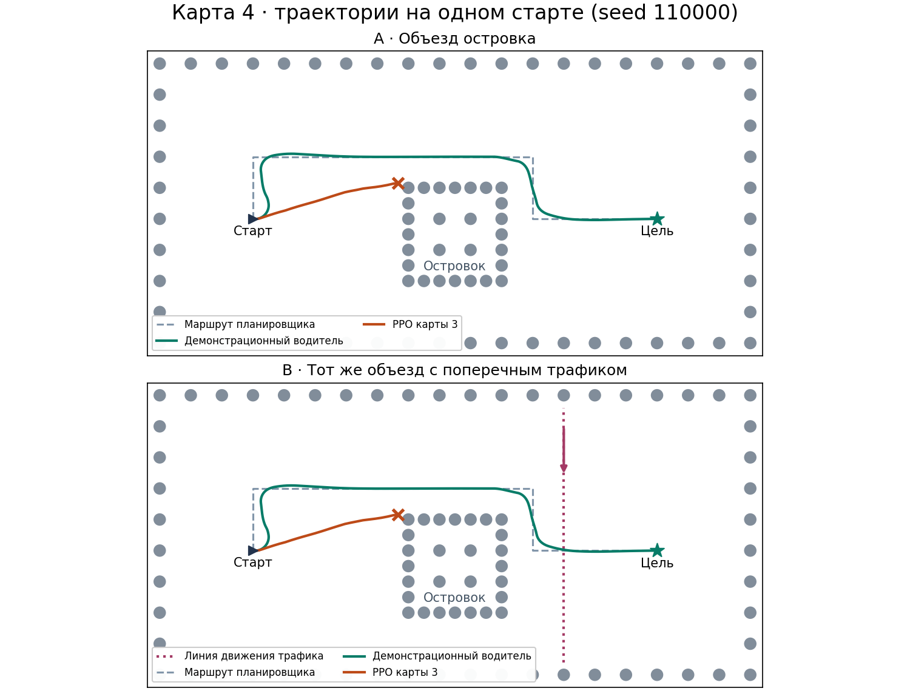

# Карта 4 · проверка переноса PPO

Случайные старты на знакомой карте меняют курс, скорость и фазу трафика. Чтобы проверить реакцию на новую планировку, взяли одну карту с островком и два варианта. В A такси объезжает островок. В B к тому же объезду добавляется машина, которая движется поперёк выезда. Старт, цель, статические препятствия и опорный маршрут совпадают. Веса взяты из четырёх готовых моделей.



Серые круги показывают коллайдеры. По периметру островка они расставлены так, что такси не помещается между ними. Крест отмечает столкновение PPO на seed 110000. Демонстрационный водитель пользуется полным состоянием, включая позиции трафика. Его парковки подтверждают, что обе планировки проходимы.

| Проверка проходимости | A · островок | B · островок и трафик |
| --- | ---: | ---: |
| Демонстрационный водитель, фиксированный старт | Парковка за 37.97 с | Парковка за 42.87 с |
| Демонстрационный водитель, случайные старты | 32/32 парковок | 32/32 парковок |
| Минимальный зазор по всем 33 поездкам | 2.72 | 0.30 |

Скорость поперечной машины подобрана так, чтобы на фиксированном старте она встретилась демонстрационному водителю на выезде после островка. Заезд с трафиком занял на 4.90 с больше.

| Готовая модель | A · парковки / столкновения / таймауты | B · парковки / столкновения / таймауты |
| --- | ---: | ---: |
| PPO карты 0 | 2 / 0 / 126 | 11 / 0 / 117 |
| PPO карты 1 | 0 / 0 / 128 | 0 / 0 / 128 |
| PPO карты 2 | 0 / 0 / 128 | 0 / 0 / 128 |
| PPO карты 3 | 0 / 128 / 0 | 0 / 128 / 0 |

У каждой PPO было 128 одинаковых ключей сброса в A и B, seed 110000–110127. У демонстрационного водителя использовали первые 32 ключа и один фиксированный старт. Физика работала в `float32` с частотой 30 Гц. Каждая PPO управляла со своей опубликованной частотой, выбирая детерминированное действие. Лимит поездки составил 100 с. Успех требует остановки в радиусе одной единицы от цели.

На исходной карте 3 её модель припарковалась во всех 128 заездах с теми же ключами. На новой планировке она сталкивалась ещё до полосы трафика, примерно на шестой секунде. PPO карты 1 объезжала островок, но в обоих вариантах останавливалась примерно в 1.5 единицы от цели, за пределами зоны парковки. PPO карты 0 припарковалась в обоих вариантах на двух стартах. На девяти других она припарковалась в B после таймаута в A. Это наблюдение на одной планировке с одним сценарием трафика.

Из каталога `assignment-2` можно повторить сравнение и построить рисунок.

```bash
python src/evaluate_map4.py
```

Демонстрационную поездку можно посмотреть из каталога `assignment-1`.

```bash
python src/main.py --map 4 --demo
python src/main.py --map 4 --demo --cross-traffic
```

[Исходы по каждому старту и контрольные суммы весов](results.json) · [Код оценки](../../src/evaluate_map4.py)
